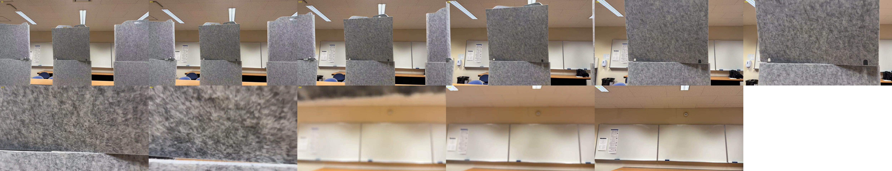
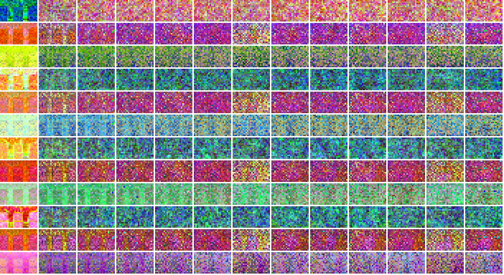

# MiniMax-H3: DiffWAM hidden features vs. the whole decoded video

**Date:** 2026-11-03. **Hardware:** 1× NVIDIA H100 80GB (Slurm `gpu1`), CPU offload.
**Code:** `h3/h3_features.py`, `h3/generate_video.py`, `h3/benchmark.py`. **Raw numbers:** [`results/h3/benchmark.json`](../results/h3/benchmark.json)

## TL;DR

| | DiffWAM features | DiffWAM-Flash features | Whole decoded video |
|---|---:|---:|---:|
| DiT evaluations | 4 (the 4th stops after block 35) | 1 (stops after block 35) | 49 |
| VAE decode (video + audio) | no | no | yes |
| **Compute time** (weights resident on GPU) | **8.0 s** | **1.8 s** | **95.1 s** |
| End-to-end on 1 H100 with CPU offload | 119.8 s | 113.6 s | 199.5 s |
| Output | `Z (4, 3, 39, 15, 26, 5376)` | `Z (1, 3, 39, 15, 26, 5376)` | 124 frames, 832×480, 24 fps + stereo audio |

- **Compute:** DiffWAM's read-out is **11.9× faster** than generating and decoding the video (8.0 s vs 95.1 s), and
  DiffWAM-Flash is **52× faster** (1.8 s). Almost all of the gap is the 45 extra DiT evaluations (~1.86 s each).
  VAE decode costs only ~3.3 s.
- **On a single 80 GB GPU, offloading dominates:** the 62 GB text encoder and the 62 GB transformer cannot both fit,
  so every request swaps both in from CPU RAM (~105–112 s). That hides most of the difference (1.7× instead of 12×).
  With the components resident (2 GPUs, `--placement multi`, or a quantised backbone), the compute numbers apply.

## Setup

- **Input:** [`assets/test.jpg`](assets/test.jpg) (1707×1280), center-cropped to 16:9 and resized to 832×480 so H3
  does not stretch it ([what H3 actually saw](../results/h3/test_video_input.jpg)). Prompt: [`assets/test_instruction`](assets/test_instruction).
- **Request:** `fl2va` (first-frame keyframe + text), 124 frames = 5.17 s at 24 fps → 37 H3 latent frames,
  50-point schedule (49 evaluations), seed 0. All three modes use the same request and seed, so they share the
  same noise: the video is exactly the completed rollout whose features DiffWAM reads.
- **DiffWAM read-out** (arXiv 2609.39763, Sec. 3): hidden states of DiT blocks **15 / 25 / 35** at schedule
  indices **0–3**. Evaluations 0–2 run fully so the scheduler advances the latent, and evaluation 3 stops right
  after block 35. No further scheduler step and no VAE decode. DiffWAM-Flash keeps only index 0.
- **Slots:** the paper uses **T_v = 39** video-time slots for **38 future poses + identity over 5 s**. H3 gives
  37 non-uniform latents for a 5 s request (it always gives `5n+2`), so `Z` is linearly resampled in time onto
  t = j·5/38 s, j = 0…38. The native times are kept in `slot_time_native_s`.

## Timing breakdown (seconds, CUDA-synchronised)

| Stage | DiffWAM | Flash | Whole video |
|---|---:|---:|---:|
| Text encoder offload (CPU → GPU) | 55.37 | 57.09 | 52.99 |
| Text encoder compute (Qwen3-VL, prompt + keyframe) | 0.10 | 0.09 | 0.09 |
| First-frame VAE encode | 0.09 | 0.10 | 0.10 |
| **DiT compute** | **7.64** | **1.46** | **90.99** |
| DiT offload (CPU → GPU) | 56.42 | 54.67 | 51.46 |
| Video VAE decode (124 frames) | – | – | 2.98 |
| Audio VAE decode | – | – | 0.30 |
| Other (layout, scheduler, post-processing) | 0.18 | 0.18 | 0.65 |
| **Total** | **119.80** | **113.59** | **199.55** |
| Compute only (total − offload) | **8.01** | **1.83** | **95.10** |

Notes:
- One full DiT evaluation over the 15,704-token packed sequence (text + keyframe + audio + 37×15×26 video
  tokens) takes **~1.86 s** on H100 in bf16 with the default attention backend (91.0 s / 49). A truncated
  evaluation (blocks 0–35) takes ~1.46 s.
- Pipeline load (from the HF cache into CPU RAM): 17 s, once per process.
- One warm-up feature run came first and is not counted. Offload time depends on the host page cache: an
  earlier cold run spent 354 s on the first evaluation.
- For reference, the paper reports DiffWAM at 3.8 s and DiffWAM-Flash at 1.08 s P50 on Jetson AGX Thor (whole
  model pipeline, Table 3), with its own optimisations.

## Results

**Whole decoded video:** [`results/h3/test_video.mp4`](../results/h3/test_video.mp4) (with H3's generated audio).
Frames every 0.5 s:



The video keeps the room, the felt partitions, the whiteboard and the ceiling lights, with smooth forward camera
motion that ends in a hover at the whiteboard. However, between ~3.5 s and 4.5 s the camera **flies through the
centre felt panel** (blurry felt texture fills the frame) and comes out on the other side. That breaks the
instruction ("pass through visible open space without intersecting solid objects"). The DiffWAM features come
from this same rollout, so a trajectory head trained on them would need geometry supervision to correct this,
which is what DiffWAM's geometry-guided distillation is for.

**Hidden features** (PCA → RGB of block-15/25/35 tokens, rows = (eval, block); first column = `A0` keyframe
tokens, then the first target slots):



- `A0` (keyframe tokens) clearly encodes the scene layout: the three panels and the whiteboard.
- `Z` (future-slot tokens) looks mostly like noise. H3's shift-12 schedule keeps schedule indices 0–3 at
  sigma 1.000 / 0.998 / 0.996 / 0.995, so these tokens carry future information only through attention to
  the keyframe and text, which is what DiffWAM's trained read-out decodes.
- Feature scale: std ≈ 290 / 400 / 900 at blocks 15 / 25 / 35, with a few outlier channels up to ~9×10⁵.
  Normalise per channel before any head (DiffWAM uses a per-layer norm + 5376→512 projection).

## Reproduce

```bash
# inside a 1-GPU srun shell (needs ~150 GB host RAM for CPU offload), conda env sakana_dreamer
cd ~/sakana_dreamer/h3
bash run_test.sh                                   # smoke test, features + PCA, whole video
python benchmark.py --image assets/test.jpg --prompt-file assets/test_instruction --out outputs/benchmark.json
```
