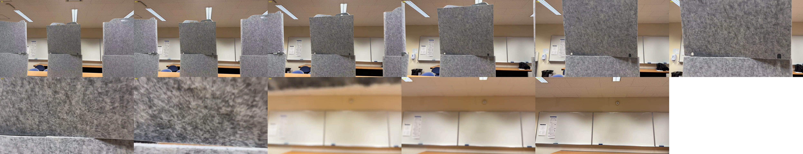
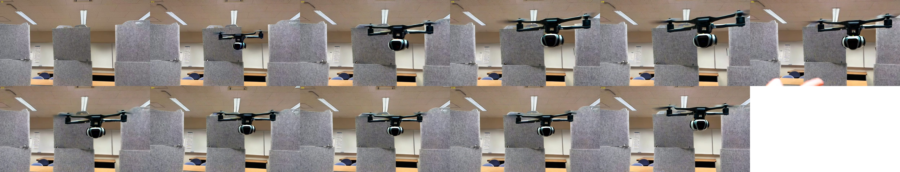

# 测试结果：MiniMax-H3 vs Wan2.2-TI2V-5B

同一张测试图 [`h3/assets/test.jpg`](../h3/assets/test.jpg)、同一条指令 [`h3/assets/test_instruction`](../h3/assets/test_instruction)、
同一个 seed（0），输入都中心裁剪到 16:9 后缩放到 832×480，生成约 5 秒的视频。硬件：1× H100 80GB（Slurm `gpu1`）。

| 文件夹 | 模型 | 内容 |
|---|---|---|
| [`h3/`](h3/) | MiniMax-H3（33B） | 完整视频 `test_video.mp4`（带音频）、帧总览、实际输入、特征 PCA 图、`benchmark.json` |
| [`wan2.2-ti2v-5b/`](wan2.2-ti2v-5b/) | Wan2.2-TI2V-5B（5B） | 完整视频 `test_video.mp4`、帧总览、实际输入、`benchmark.json` |

H3 的详细报告：[`h3/REPORT.md`](../h3/REPORT.md)。代码：[`h3/`](../h3/)、[`wan/`](../wan/)。

## 1. 模型对比

| | MiniMax-H3 | Wan2.2-TI2V-5B |
|---|---|---|
| DiT 参数 / 层数 / hidden | 33B / 50 / 5376 | 5B / 30 / 3072 |
| 文本编码器 | Qwen3-VL（约 62 GB） | umT5-XXL（约 11 GB） |
| 一张 H100 能否放下全部权重 | ❌ 需要 CPU offload | ✅ 峰值 34.4 GB |
| 视频 | 124 帧 / 24 fps / 5.17 s → 37 个潜帧 | 121 帧 / 24 fps / 5.04 s → 31 个潜帧 |
| token 网格 | 15 × 26 | 15 × 26（VAE 16×16×4 + patch 1×2×2） |
| 每次前向的 token 数 | 15,704（文本 + 首帧 + 音频 + 视频） | 12,090（只有视频；文本走 cross-attention） |
| 引导方式 | 蒸馏，每步 1 次前向 | CFG 5.0，每步 2 次前向（有条件 + 无条件） |
| DiffWAM 抽取层 | 15 / 25 / 35 | 9 / 15 / 21（相同的相对深度） |
| 特征 `Z` | (4, 3, 39, 15, 26, 5376) | (4, 3, 39, 15, 26, 3072) |

## 2. 运行时间（秒，CUDA 同步计时）

**计算时间**（不算搬运权重）：

| | DiffWAM（4 步） | DiffWAM-Flash（1 步） | 完整视频 + 解码 |
|---|---:|---:|---:|
| **MiniMax-H3** | 8.01 | 1.83 | 95.10 |
| **Wan2.2-TI2V-5B** | **3.43** | **0.51** | **48.97** |
| Wan 比 H3 快 | 2.3× | 3.6× | 1.9× |

**实际端到端**（在一张 H100 上）：

| | DiffWAM | Flash | 完整视频 |
|---|---:|---:|---:|
| MiniMax-H3（CPU offload，每个请求要搬约 124 GB 权重） | 119.8 | 113.6 | 199.5 |
| Wan2.2-TI2V-5B（全部常驻显存，无 offload） | **3.4** | **0.5** | **49.0** |

**Wan 的分阶段时间：**

| 阶段 | DiffWAM | Flash | 完整视频 |
|---|---:|---:|---:|
| 文本编码（umT5） | 0.05 | 0.05 | 0.05 |
| 首帧 VAE 编码 | 0.02 | 0.02 | 0.02 |
| DiT 计算 | 3.24（7 次前向） | 0.38（1 次） | 42.85（100 次） |
| VAE 解码（121 帧，fp32） | – | – | 4.54 |
| 其他 | 0.12 | 0.06 | 1.51 |

要点：
- **特征 vs 完整视频：** H3 上 DiffWAM 比完整视频快 11.9×（Flash 快 52×）；Wan 上快 14.3×（Flash 快 96×）。
  主要差别都是少跑的去噪步数，VAE 解码只占几秒。
- **单次前向：** H3 约 1.86 s，Wan 约 0.43 s（约 1/4）。Wan 因为用 CFG 每步要跑两次，所以完整视频只比 H3 快一倍左右。
  如果关掉 CFG（`--guidance-scale 1`），Wan 的完整视频大约能再快一倍，但画质可能下降，尚未测试。
- **Wan 不需要搬权重**，所以实际端到端时间和计算时间基本一样。这是换小模型最大的收益。

## 3. 生成质量

**MiniMax-H3**（[视频](h3/test_video.mp4)）：



- ✅ 第一人称视角，保持了房间、隔板、白板和灯的布局，镜头平滑向前，最后悬停在白板前。
- ❌ 约 3.5–4.5 s **穿过了中间的毛毡隔板**，违反"不与实体物体相交"的要求。

**Wan2.2-TI2V-5B**（[视频](wan2.2-ti2v-5b/test_video.mp4)）：



- ✅ 保持了场景，画面清晰、稳定。
- ❌ **不是第一人称**：模型在画面里"加"了一架无人机，镜头基本不动，变成第三人称看无人机悬停，正好违反指令里的
  "no third-person drone"。最后一帧右上角有伪影。
- 可能的原因：指令里多次出现 "drone"，5B 模型理解成"画一架无人机"；另外 TI2V-5B 的原生分辨率是 720p
  （1280×704），832×480 不是它的最佳设置。可以尝试的改法（未测试）：提示词改成只描述镜头运动（例如
  "the camera moves forward ..."，不提 drone），负向提示词加上 "drone, quadcopter, aircraft"，或者用 1280×704。

## 4. 结论

- 做 DiffWAM 式的特征实验和快速迭代，**Wan2.2-TI2V-5B 足够轻**：一张 H100 放得下，特征 3.4 s（Flash 0.5 s），完整视频 49 s。
- 但这次测试中 **H3 对第一人称指令的理解明显更好**；Wan 需要调整提示词后再比较。
- 两个模型都没有真正理解"不能穿过障碍物"，这正是 DiffWAM 用几何蒸馏（MoGe2 / Pi3）来纠正的部分。

## 复现

```bash
# conda env sakana_dreamer，在 1 卡 srun 里
cd ~/sakana_dreamer/h3  && python benchmark.py --image assets/test.jpg --prompt-file assets/test_instruction --out outputs/benchmark.json
cd ~/sakana_dreamer/wan && python benchmark.py --image ../h3/assets/test.jpg --prompt-file ../h3/assets/test_instruction \
                              --out outputs/benchmark.json --video outputs/test_video.mp4
```
