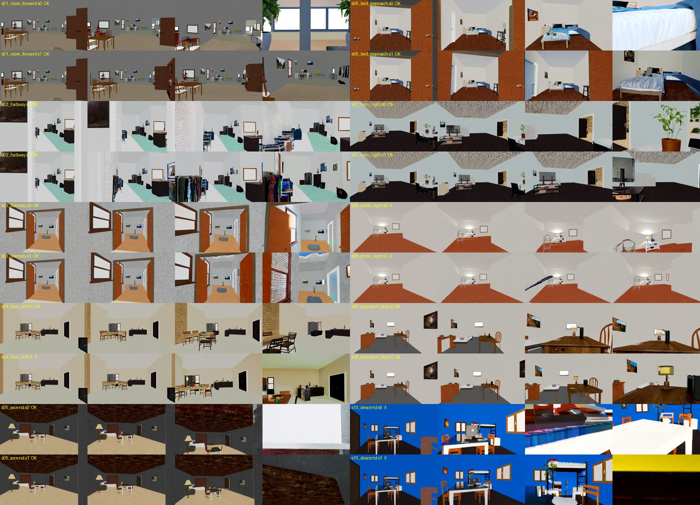
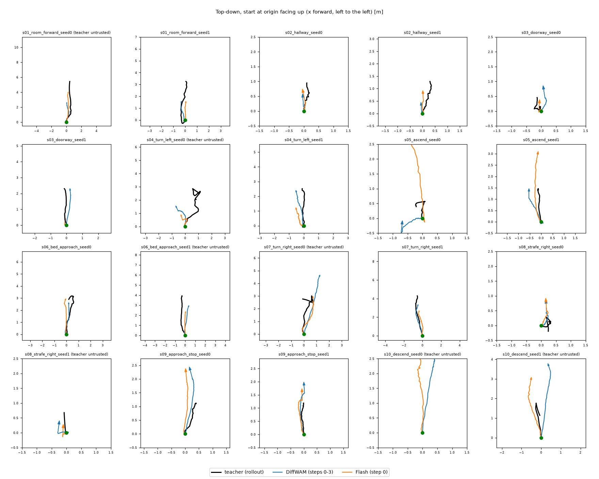

# Flying along imagined videos: Wan2.2 + HyperDrone + DiffWAM
# 按想象视频飞行：Wan2.2 + HyperDrone + DiffWAM

Date / 日期: 2026-11-03 · Hardware / 硬件: H100 GPUs on the GCP Slurm cluster (gpu1 + a3) · Branch / 分支: `follow-imagined-video`

Detailed reports / 详细报告:
[10 scenarios + latent following / 10 场景 + latent 跟随](scenarios10/README.md) ·
[DiffWAM + gen2pose](diffwam_gen2pose/README.md) ·
Code / 代码: [`follow/`](../../follow/), [`diffwam/`](../../diffwam/)

---

## Summary / 摘要

**EN.** We tested whether a drone can fly along a video imagined by Wan2.2-TI2V-5B from its first onboard frame and an
instruction. The scenes are 10 furnished ProcTHOR houses in HyperDrone (ray-traced, OptiX on H100). Three findings:

1. **Imagination works if prompted as camera motion.** 20/20 imagined videos move, and 15/20 move in the instructed
   direction. Wan never strafes, and it sometimes flies through ceilings or tables.
2. **Matching onboard images to DiffWAM-Flash features fails; VAE latents work.** At step 0, Flash features are
   dominated by the sampled noise, so no image encoder can map onboard views onto them (held-out R² −0.14; with the
   same scenes and a new seed, R² 0.03). Following the imagined video with Wan VAE latents as the goal works:
   9/10 flights move as instructed.
3. **The DiffWAM method works.** A readout head on the step 0–3 features predicts the imagined trajectory (supervised
   by a gen2pose teacher from the completed rollout) with **half the error** of an instruction-only prior in unseen
   houses. Blanking the future-slot features removes the gain, so the information comes from the imagination. Flying
   these predictions gives 13/20 correct motions, against 12/20 for the slow full-video teacher, at about 1/10 of the
   cost (3.2 s vs 34 s).

**中文。** 我们测试了无人机能否按照 Wan2.2-TI2V-5B 根据机载首帧和指令"想象"出来的视频飞行。场景是 HyperDrone 中 10 栋带家具的
ProcTHOR 房子（光线追踪，H100 上用 OptiX）。三点结论：

1. **按镜头运动写提示词，想象就能用。** 20/20 的想象视频都在动，15/20 的运动方向与指令一致；但 Wan 从不平移，有时会穿过天花板或桌面。
2. **把机载画面对齐到 DiffWAM-Flash 特征不行，VAE latent 可以。** Flash 第 0 步的特征主要由采样噪声决定，任何图像编码器都对不上
   （没见过的场景 R² −0.14；同场景换 seed R² 0.03）。改用 Wan VAE latent 作为目标跟随想象视频，9/10 的飞行方向正确。
3. **DiffWAM 方法有效。** 用第 0–3 步特征训练读出头（监督来自完整视频的 gen2pose 老师）预测想象中的轨迹，在没见过的房子里误差约为
   只看指令的**一半**；把未来时间槽的特征清零后优势消失，说明信息来自想象。按预测轨迹飞：13/20 方向正确，与完整视频老师
   （12/20）相当，耗时约 1/10（3.2 s 对 34 s）。

---

## 1. Setup / 设置

| | EN | 中文 |
|---|---|---|
| Video model / 视频模型 | Wan2.2-TI2V-5B (diffusers), 832×480, 121 frames, 24 fps, CFG 5, Wan's official negative prompt | Wan2.2-TI2V-5B（diffusers），832×480，121 帧，24 fps，CFG 5，官方负向提示词 |
| Simulator / 仿真器 | HyperDrone / hyperlux (OptiX ray tracing), ProcTHOR houses, level onboard camera, 90° HFOV | HyperDrone / hyperlux（OptiX 光线追踪），ProcTHOR 房子，水平稳定的机载相机，水平视场 90° |
| Scenarios / 场景 | 10 houses × 1 take-off point, one instruction each: forward, hallway, doorway, turn left/right, ascend, descend, bed approach, approach + stop, strafe right | 10 栋房子各 1 个起飞点，每个一条指令：前进、走廊、穿门、左/右转、上升、下降、接近床、接近并停下、右平移 |
| DiffWAM slots / 时间槽 | 39 slots at t = j·5/38 s (identity + 38 future poses), 15×26 token grid | 39 个槽 t = j·5/38 s（起点 + 38 个未来位姿），15×26 token 网格 |

## 2. Imagination quality / 想象质量

**EN.** The first prompts ("smooth, steady, preserve the room, never pass through walls") produced **still images**
(0.5 px of optical flow). Describing the camera move instead ("Fast forward dolly shot … strong forward camera
motion, objects get closer and larger every second") gives 6.8 px. With these prompts, 20/20 videos move and **15/20
move in the instructed direction** (8/10 scenarios with at least one good seed). Strafing never happens; ascent goes
into the ceiling; one descent dives into the table; some videos invent objects.

**中文。** 最初的提示词（"平稳、保持房间不变、不要穿墙"）生成的是**静止画面**（光流 0.5 px）。改成描述镜头运动后达到 6.8 px。
用新写法，20/20 的视频都在动，**15/20 方向正确**（10 个场景中 8 个至少一个 seed 成功）。从不平移；上升会穿进天花板；有一次下降冲进桌面；
有时会编造物体。

Imagined videos / 想象视频: [`scenarios10/imagination/`](scenarios10/imagination/) —
e.g. [bed approach / 接近床](scenarios10/imagination/s06_bed_approach_seed0.mp4),
[turn right / 右转](scenarios10/imagination/s07_turn_right_seed0.mp4),
[approach + stop / 接近并停下](scenarios10/imagination/s09_approach_stop_seed0.mp4),
[strafe (failed) / 平移（失败）](scenarios10/imagination/s08_strafe_right_seed0.mp4).

## 3. Following in a latent space / 在 latent 空间中跟随

**EN.** The controller tries 135 velocity commands per slot (0.13 s). It renders each candidate's next onboard view,
encodes it, and picks the smallest latent error to the next goal slot (plus a collision penalty). Motion is
kinematic; the simulator serves as the predictive model.

**中文。** 控制器每个时间槽（0.13 s）尝试 135 个速度指令，渲染每个候选的下一帧机载画面并编码，选与下一个目标 latent 误差最小的
（加碰撞惩罚）。运动是运动学的，模拟器充当预测模型。

| Goal / 目标 | Latent space / 空间 | Result / 结果 |
|---|---|---|
| Scripted reference flight (ground truth), start offset 0.25 m / 8° / 有真值的脚本飞行，起点偏 0.25 m / 8° | pixel / VAE / encoder E | 9/10, 9/10, **10/10** succeed / 成功; RMSE 0.19 / 0.21 / **0.14 m** (hover 悬停 1.33 m) |
| Wan imagined video / Wan 想象视频 | **VAE latent** | **9/10** correct motion / 方向正确 (8/8 where the imagination was correct / 想象正确的 8/8) |
| Wan imagined video / Wan 想象视频 | Flash features + encoder / Flash 特征 + 编码器 | 2/10 (barely moves / 几乎不动) |

Why Flash fails here / Flash 失败原因: encoder held-out R² −0.14; same scenes with new noise R² 0.03 → step-0 future
tokens (timestep 999/1000) encode the sampled noise, not the image / 第 0 步未来 token（timestep 999/1000）编码的是采样噪声，不是画面。

Flight videos (goal | onboard) / 飞行视频（目标 | 机载画面）: [`scenarios10/follow/`](scenarios10/follow/) —
e.g. [turn right, VAE / 右转 VAE](scenarios10/follow/s07_turn_right_wan_vae_seed0.mp4),
[bed approach, VAE / 接近床 VAE](scenarios10/follow/s06_bed_approach_wan_vae_seed0.mp4),
[replay, encoder / 回放 编码器](scenarios10/follow/s04_turn_left_replay_flash.mp4).

## 4. DiffWAM method with gen2pose / DiffWAM 方法与 gen2pose

**EN.** 450 training samples (80 ProcTHOR houses × 3 take-offs × 2 instruction/seed draws; the evaluation houses are
held out). Per sample:
- the DiffWAM features (steps 0–3, blocks 9/15/21, PCA to 128 channels per layer);
- the completed rollout from the same noise;
- teacher poses from **gen2pose**: KLT tracking + PnP, scaled by the true first-frame depth, with triangulated
  re-seeding. This stands in for Pi3 + MoGe2, because installing Pi3's code was blocked by the permission policy.
  Validated on rendered flights: 2–8 cm ATE for translating motions, 26 cm for pure 87° rotation.

The readout head is a compact DiffWAM head: per-layer projection, softmax layer fusion, 312 memory tokens,
38 pose queries; 1.6 M parameters.

**中文。** 450 条训练样本（80 栋 ProcTHOR 房子 × 3 个起飞点 × 2 组指令/seed，评估场景的房子不参与训练）。每条样本包含：
- DiffWAM 特征（步 0–3，块 9/15/21，每层 PCA 到 128 维）；
- 同一噪声生成的完整视频；
- 用 **gen2pose** 得到的老师位姿：KLT 跟踪 + PnP，用首帧真实深度定尺度，并通过三角化补充新点。它代替了 Pi3 + MoGe2，因为安装 Pi3 代码被权限策略拦下。
  在渲染飞行上验证过：有平移的运动 ATE 2–8 cm，纯 87° 旋转 26 cm。

读出头是 DiffWAM 结构的精简版：逐层投影、softmax 层融合、312 个记忆 token、38 个位姿查询，160 万参数。

| ADE / FDE (m) | **DiffWAM (steps 0–3)** | Flash (step 0) | Scene only / 只看场景 | Instruction prior / 指令先验 | Hover / 悬停 |
|---|---:|---:|---:|---:|---:|
| Val, unseen houses / 验证（没见过的房子） | **0.27 / 0.44** | 0.39 / 0.71 | 0.40 / 0.72 | 0.45 / 0.85 | 0.45 / 0.86 |
| Test, eval scenarios / 测试（评估场景） | **0.52 / 0.96** | 0.67 / 1.40 | 0.77 / 1.55 | 0.73 / 1.32 | 0.98 / 1.85 |

Top-down: black = teacher, blue = DiffWAM, orange = Flash. / 俯视图：黑 = 老师，蓝 = DiffWAM，橙 = Flash。

**Closed loop in HyperDrone / HyperDrone 闭环（20 test scenarios / 20 个测试场景）:**

| Path / 路径 | Correct motion / 方向正确 | Collisions / 碰撞 | Time per decision / 每次决策耗时 |
|---|---:|---:|---|
| **DiffWAM features → head / 特征 → 读出头** | **13/20** | 2 | 3.2 s + 17 ms |
| Flash features → head | 11/20 | 4 | ~1 s + 18 ms |
| Full video → gen2pose (teacher) / 完整视频 → gen2pose（老师） | 12/20 | 1 | 33 s + 1 s |

Flight videos (imagined rollout | onboard) / 飞行视频（想象视频 | 机载画面）: [`diffwam_gen2pose/flights/`](diffwam_gen2pose/flights/) —
e.g. [doorway DiffWAM / 穿门](diffwam_gen2pose/flights/s03_doorway_seed1_diffwam.mp4),
[turn right DiffWAM / 右转](diffwam_gen2pose/flights/s07_turn_right_seed1_diffwam.mp4),
[approach + stop DiffWAM / 接近并停下](diffwam_gen2pose/flights/s09_approach_stop_seed0_diffwam.mp4),
[ascend into ceiling / 上升撞天花板](diffwam_gen2pose/flights/s05_ascend_seed1_diffwam.mp4).

## 5. Conclusions and next steps / 结论与下一步

**EN.**
- Wan2.2 is a usable imaginer for indoor first-person flight if prompted as camera motion, but it inherits video-model
  physics: no strafing, passing through ceilings and tables, invented objects.
- DiffWAM features are **not** a goal space for onboard images (noise-dominated), but they **are** a strong input for
  predicting the imagined trajectory, because the supervision comes from the same noise's completed rollout.
- Fast DiffWAM readout ≈ slow full-video reconstruction in flight, at about 1/10 of the time.
- Limits: 284 trusted samples (about 1/1800 of the paper), an OpenCV teacher instead of Pi3, kinematic flight.
- Next: more data (about 5k samples, ~15 GPU-hours on a3); Pi3 as teacher if its install is approved; collision and
  free-space constraints from the I0 depth; L2F dynamics with a position controller; closed-loop replanning every
  1–2 s; an RL policy with the VAE latent error as reward.

**中文。**
- 用镜头运动的写法提示，Wan2.2 可以作为室内第一人称飞行的想象器，但会继承视频模型的物理错误：不会平移、穿过天花板和桌面、编造物体。
- DiffWAM 特征**不能**作为机载画面的目标空间（被噪声主导），但**可以**作为预测想象轨迹的输入，因为监督来自同一噪声的完整视频。
- 飞行效果上，快速的 DiffWAM 读出 ≈ 慢速的完整视频重建，耗时约 1/10。
- 局限：可信样本 284 条（约为论文的 1/1800）；老师是 OpenCV 而非 Pi3；飞行是运动学的。
- 下一步：更多数据（约 5000 条，a3 上约 15 GPU 小时）；如获允许，换 Pi3 做老师；用 I0 深度加碰撞/可通行约束；
  L2F 动力学 + 位置控制器；每 1–2 s 闭环重规划；用 VAE latent 误差做奖励训练 RL 策略。

## Reproduce / 复现

See the detailed reports above / 见上方详细报告. Environments / 环境: conda `sakana_dreamer` (Wan2.2, diffusers main),
conda `sakana_hyperdrone` (HyperDrone + torch + diffusers). Generated data (~40 GB) is not in git / 生成数据（约 40 GB）不在 git 里。
