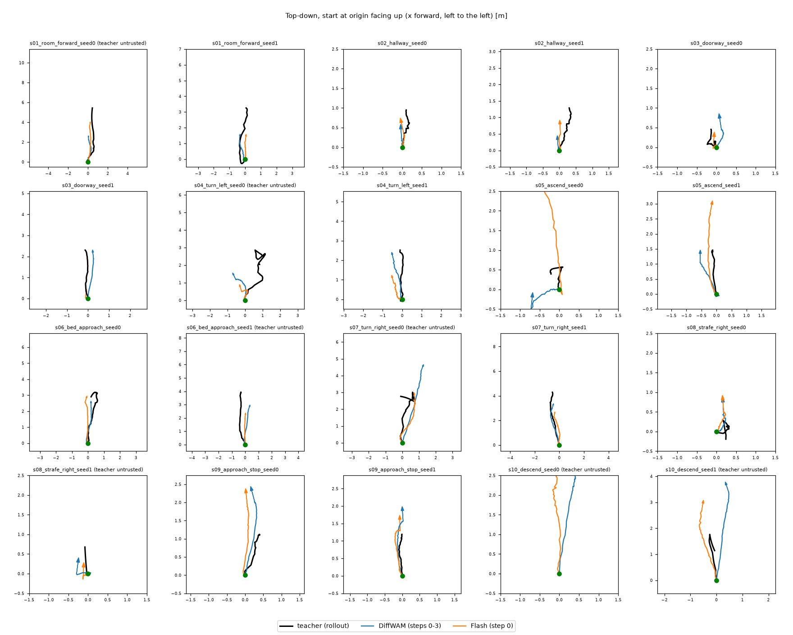

# DiffWAM 方法跑通：Wan2.2 特征 → gen2pose 老师 → 读出头 → HyperDrone 飞行

日期：2026-11-03。硬件：3× H100（a3 2 张 + gpu1 1 张）。代码：[`diffwam/`](../../../diffwam/)。
对照论文：DiffWAM（arXiv 2609.39763）Sec. 3。

## 流程

```
训练（离线）                                              部署（在线，快路径）
I0 + 指令 + 噪声 ──Wan2.2──> DiffWAM 特征 (步 0–3, 块 9/15/21) ──读出头──> 38 个未来位姿 ──> 无人机飞行
           └─同一噪声完成整段视频──> gen2pose ──> 老师位姿（监督）     慢路径：完整视频 → gen2pose → 位姿 → 飞行
```

| 环节 | DiffWAM 论文 | 这次 |
|---|---|---|
| 视频模型 | MiniMax H3 | Wan2.2-TI2V-5B，832×480，121 帧，30 步，CFG 5 |
| 特征 | 步 0–3，DiT 块 15/25/35，5376 维 | 步 0–3，块 9/15/21（相同相对深度），3072 维 → 每层 PCA 128 维（存储） |
| 老师（gen2pose） | Pi3 重建 + MoGe2 定尺度 | **深度锚定的视觉里程计**：I0 的仿真真实深度 + KLT 跟踪 + PnP + 三角化（Pi3 代码安装被权限系统拦下，见下） |
| 数据 | 51 万条（FlyMirage + NavGen） | **450 条**：80 栋 ProcTHOR 房子 × 3 个起飞点 × 2（指令, seed），9 种镜头运动指令 |
| 读出头 | 逐层归一化+投影、层融合、4 个时空块、记忆池化 312 token、38 个位姿查询、8 层解码器 | 同样结构的精简版：记忆 39×8=312 token，2 层编码器，4 层解码器，160 万参数 |
| 测试 | DiffWAM-1000 | **10 个评估场景 × 2 seed = 20 条**，房子完全不在训练集里 |

## 1. gen2pose 老师的精度

在 HyperDrone 渲染的**有真值**飞行上验证（10 栋房子 × 7 种运动，[`gen2pose_validation.json`](gen2pose_validation.json)）：

| 运动 | 轨迹误差 ATE | 终点误差 | 路径长 |
|---|---:|---:|---:|
| 前进 | 3.6 cm | 6.1 cm | 3.0 m |
| 前进 + 左/右转 | 6–8 cm | 15–18 cm | 2.0 m |
| 上升 / 下降 / 右平移 | 1.6–4.6 cm | 2.5–8 cm | 1.1–1.6 m |
| 原地右转 87° | 26 cm | 61 cm | 0 m |

有平移的运动误差只有几厘米；纯旋转是弱项（没有平移就无法三角化新点）。在 **Wan 生成的视频**上，老师更难：
训练集 450 条里只有 **284 条（63%）**通过可信度过滤（≥ 70% 的帧 PnP 成功、速度 < 2.5 m/s、终点 < 7 m），测试集 20 条里 13 条。
失败的通常是视频后段"崩坏"的那些（比如冲进桌面、编造新场景）。

## 2. 读出头：从特征预测位姿

ADE / FDE = 38 个位姿的平均 / 终点位置误差（与老师比），只在老师可信的样本上算
（[`diffwam_metrics.json`](diffwam_metrics.json)、[`flash_metrics.json`](flash_metrics.json)、[`diffwam_scene_only_metrics.json`](diffwam_scene_only_metrics.json)）：

| ADE / FDE (m) | **DiffWAM（步 0–3）** | DiffWAM-Flash（步 0） | 只看场景（未来槽特征清零） | 指令先验 | 悬停 |
|---|---:|---:|---:|---:|---:|
| 验证（训练池里留出的 11 栋房子，37 条） | **0.27 / 0.44** | 0.39 / 0.71 | 0.40 / 0.72 | 0.45 / 0.85 | 0.45 / 0.86 |
| 测试（10 个评估场景，13 条） | **0.52 / 0.96** | 0.67 / 1.40 | 0.77 / 1.55 | 0.73 / 1.32 | 0.98 / 1.85 |

- **DiffWAM 读出有效**：在没见过的房子里，误差约为"只看指令"的一半。
- **信息来自想象**：把 39 个未来槽的特征清零（只保留首帧 A0 和 I0 深度），效果退回到指令先验的水平。
  也就是说，Flash/DiffWAM 特征虽然被噪声主导、机载画面对不上（上一个实验的结论），但**它们包含"这一次采样会往哪飞"的信息**，
  而读出头正是在同一噪声的完整视频上训练的，所以能把它解码出来。这正是 DiffWAM 的核心论点。
- **4 步明显好于 1 步**（论文：RMSE 0.50 → 0.35 m；这里验证 ADE 0.39 → 0.27 m）。
- 三层的 softmax 融合权重几乎均匀（0.33/0.34/0.33），数据量下没学出偏好。



（俯视图，起点在原点朝上。黑：老师；蓝：DiffWAM；橙：Flash。很多场景里 DiffWAM 能跟上老师轨迹的具体形状——走廊、穿门、接近床、右转、
接近并停下；Flash 多数只是"直着往前"。）

## 3. 闭环：在 HyperDrone 里按预测位姿飞

20 个测试场景（不过滤老师），无人机按 39 个槽位姿运动学跟踪（≤ 1.5 m/s，≤ 1.2 rad/s），每个子步检查碰撞（画面中心 < 0.25 m）。
运动方向按指令判断（与上一个实验相同的规则）。视频在 [`flights/`](flights/)（左：Wan 想象的视频；右：无人机机载画面）。

| 路径 | 飞对方向 | 碰撞 | 每次决策的耗时 |
|---|---:|---:|---|
| **快：DiffWAM 特征 → 读出头** | **13/20** | 2 | 特征 **3.2 s**（4 步 × CFG 两次前向）+ 读出头 **17 ms** |
| 快：Flash 特征 → 读出头 | 11/20 | 4 | 特征约 1 s + 读出头 18 ms |
| 慢：完整视频 → gen2pose（老师） | 12/20 | 1 | 视频 **33 s** + gen2pose **1 s** |

- **快路径和慢路径效果相当，耗时约 1/10。** 想象本身的错误两条路径都会继承：
  - 上升场景（s05）DiffWAM 的两次飞行都撞了天花板（预测上升 1.4–1.9 m）——Wan 想象的就是穿进天花板；
  - 右平移（s08）全部失败——Wan 从来不生成平移。
- 转弯时，读出头预测的偏航方向正确（右转 −16° ~ −21°，左转 +13° ~ +26°），比老师在这些测试视频上测出的偏航还明显
  （老师对近似纯旋转本来就弱）。

## 4. 结论

1. **DiffWAM 的方法在 Wan2.2 + HyperDrone 上跑通了**：只用前 4 步的特征（约 3 s，不解码），读出头就能预测想象的飞行轨迹，
   在没见过的房子里误差约为只看指令的一半；在仿真里按它飞，效果和"生成完整视频再重建"相当，速度快约 10 倍。
2. 和上一个实验对比：Flash 特征**不能**当作"机载画面应该长什么样"的目标（噪声主导），但**能**当作"这次会往哪飞"的输入——
   因为监督信号来自同一份噪声的完整视频。
3. 局限：数据量（284 条可信样本）比论文小 3 个数量级；老师是 OpenCV 视觉里程计而不是 Pi3；飞行是运动学跟踪，不是动力学；
   想象中的物理错误（穿天花板、不平移）会被原样继承，需要像论文那样用几何信息（深度、碰撞）约束。

## 下一步

- 更多数据（论文规模的 1%，约 5000 条，用 a3 多卡约 15 小时），以及 Pi3 老师（需要你允许安装它的代码）；
- 在读出头里加入碰撞/可通行约束（I0 深度已经有了），或者用深度对预测轨迹做后处理；
- 用 L2F 动力学 + 位置控制器替换运动学跟踪；把整个流程部署成闭环重规划（每 1–2 s 重新拍 I0、重新预测）。

## 复现（目录 `diffwam/`）

```bash
python make_starts.py                                   # sakana_hyperdrone：80 栋房子的起飞点 + I0 + 深度
python fit_feature_pca.py                               # 每层 3072 → 128 的 PCA
python wan_worker.py --shard 0 --num-shards 3 --gpu 0   # sakana_dreamer：特征 + 完整视频（每张卡一个）
python label_teacher.py                                 # gen2pose 老师（CPU）
python validate_gen2pose.py                             # 在有真值的渲染飞行上验证老师
python make_eval_samples.py && python wan_worker.py --samples data/samples_eval && python label_teacher.py --samples data/samples_eval
python train_head.py --evals 0 1 2 3                    # DiffWAM（--evals 0：Flash；--zero-future：只看场景）
python deploy.py --head data/head/diffwam.pt            # HyperDrone 闭环
python plot_results.py && python collect_results.py
```
