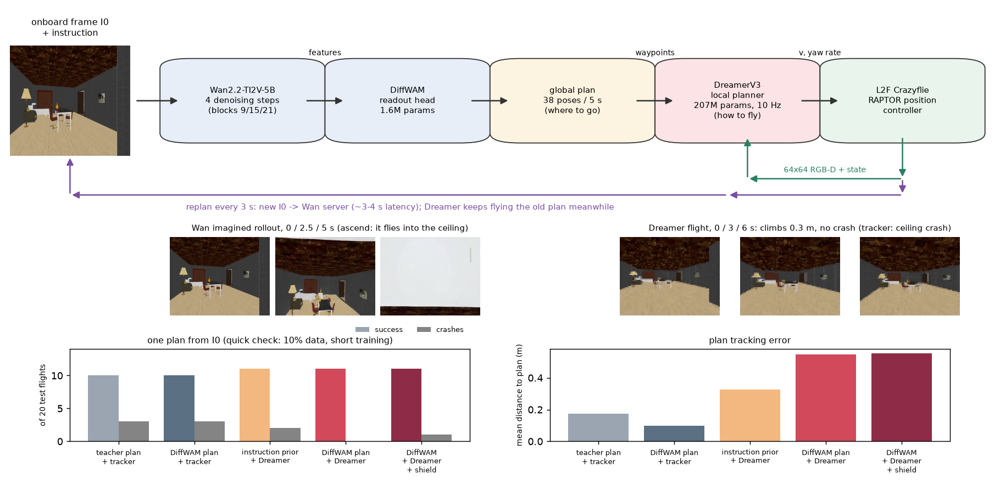
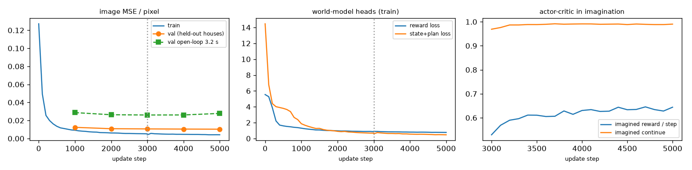
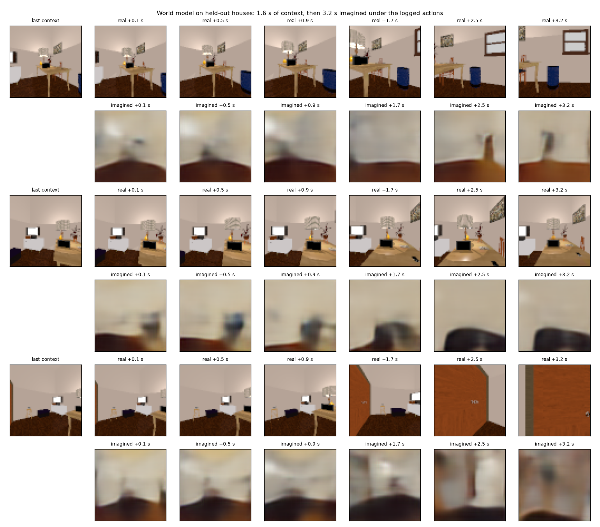
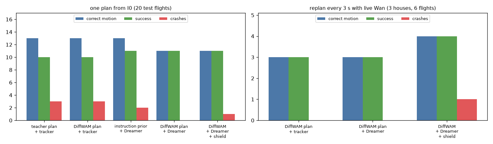
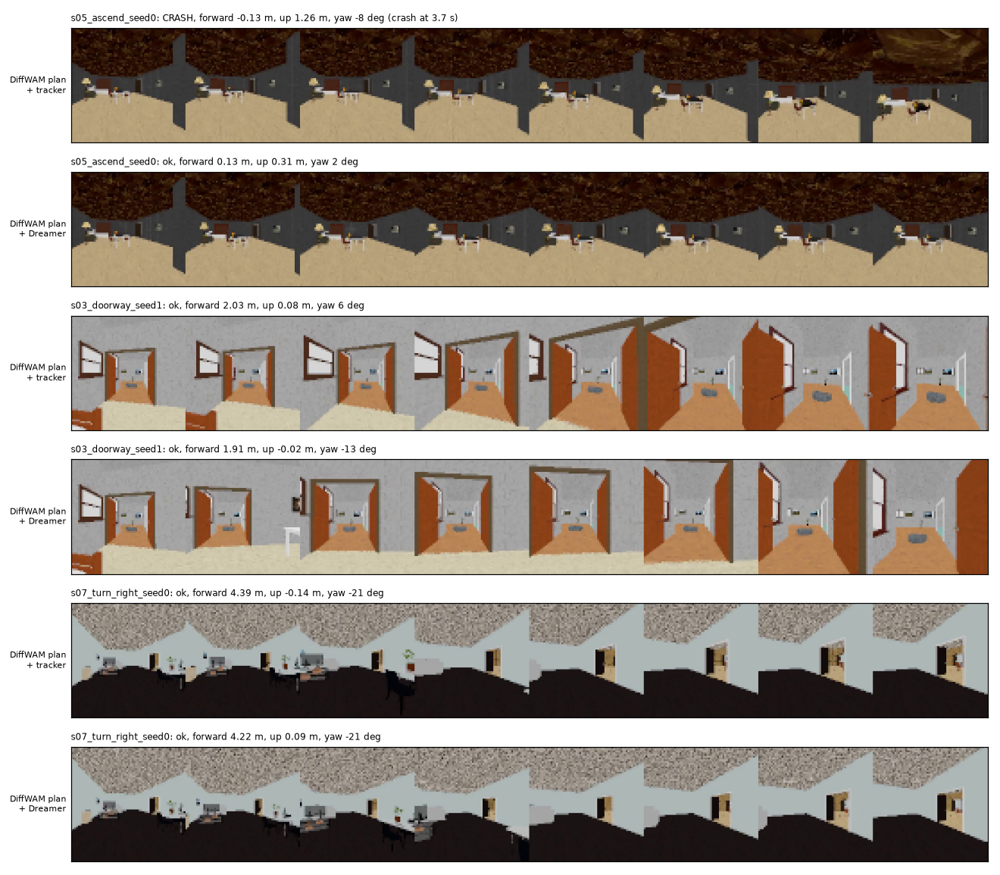

# Wan2.2 global planner + DreamerV3 local planner (quick check)

Date: 2026-11-04 · Hardware: 1× H100 (GCP Slurm, gpu1) · Branch: `dreamer-local-planner` · Code: [`dreamer/`](../../../dreamer/)
Chinese version below / 中文版见下方: [中文](#中文版)

> **Status: quick check, not the final result.** The point of this run was to test the whole workflow end to end before
> the full-scale training. It used **10% of the collected data** (16 of 160 house-rounds, 205k frames) and **short
> training** (3k world-model steps + 2k actor-critic steps, about 25 min). Each test case was flown once, so
> differences of 1–2 flights out of 20 are within noise. The full run (2.05M frames, 60k + 20k steps) comes next.



---

## 1. Idea

Wan2.2 imagines where the drone should go, but it does not know physics: in the earlier experiments it flew through
ceilings and tables and never strafed. A world model trained on **real flights** knows the physics of the next few
seconds and runs in milliseconds, but it does not understand instructions such as "fly through the doorway".
So the two are combined as a hierarchy:

| | Global planner | Local planner |
|---|---|---|
| Model | Wan2.2-TI2V-5B, 4 denoising steps → DiffWAM readout head | DreamerV3 (size200m, 207M params) |
| Input | onboard frame I0 + instruction | 64×64 RGB-D + state + next 8 plan waypoints |
| Output | 38 poses over 5 s (where to go) | velocity + yaw-rate command (how to fly) |
| Trained on | Wan imaginations, gen2pose teacher labels | real L2F flights in HyperDrone |
| Rate / latency | every 3 s, ~3–4 s per plan | 10 Hz, 3.6 ms per decision |

The two models are combined by **conditioning, not averaging**: Dreamer's policy takes Wan's waypoints as input and
decides the command. Averaging a wrong command with a right one would give a half-wrong one.

## 2. Workflow

```mermaid
flowchart LR
    subgraph data["Training data (same houses / starts / plans as diffwam/)"]
        H["80 ProcTHOR training houses<br/>456 take-off poses"] --> P["plans: Wan2.2 gen2pose teacher (456)<br/>+ 12 synthetic motion primitives"]
        P --> C["collect.py: 64 L2F drones per house<br/>track / random / safe-track policies<br/>2 rounds, 2.05M frames"]
    end
    subgraph train["DreamerV3 (PyTorch, size200m)"]
        C --> WM["world model 181.5M<br/>RSSM 8192 deter, 32x64 latents"]
        WM --> AC["actor-critic 25.4M<br/>trained in imagination"]
    end
    subgraph deploy["Flight (HyperDrone, L2F dynamics)"]
        I0["onboard frame I0 + instruction"] --> WAN["Wan2.2 server<br/>DiffWAM features, steps 0-3"]
        WAN --> HEAD["DiffWAM readout head"]
        HEAD --> PLAN["global plan: 38 poses / 5 s"]
        PLAN --> DRM["Dreamer local planner<br/>(+ optional world-model shield)"]
        AC --> DRM
        DRM --> CTRL["v_fwd, v_left, v_up, yaw rate<br/>-> carrot setpoint -> RAPTOR"]
        CTRL --> SIM["L2F Crazyflie + ray-traced camera"]
        SIM -->|"64x64 RGB-D + state, 10 Hz"| DRM
        SIM -->|"new I0 every 3 s"| WAN
    end
```



### 2.1 Simulator and task (`env.py`)

- **Dynamics:** HyperDrone L2F (Crazyflie) with `control="position"`: the built-in RAPTOR policy turns a world
  setpoint into motor commands. The previous experiments used kinematic flight. (The CUDA build of this controller does
  not compile in the vendored rl_tools; the CPU build runs 64 drones at 29 ms per control step, renders included.)
- **Action:** body-frame `(v_forward, v_left, v_up, yaw_rate)` in [-1, 1], scaled to 1.5 / 1.0 / 0.75 m/s and
  1.2 rad/s, integrated into a carrot setpoint at 100 Hz and kept within 1 m of the drone. The drone lags a moving
  setpoint by about 0.6 s, which the world model has to learn.
- **Observation:** level (gimbal) camera, 64×64 RGB + depth (90° FOV), plus body velocity, yaw rate, roll, pitch,
  height and the next 8 plan waypoints (0.25–2 s ahead) in the drone's frame (48-dim vector).
- **Crash:** the dynamics have no collision geometry, so depth is rendered in 6 directions; a crash is anything
  closer than 0.25 m horizontally or 0.15 m up/down, or leaving the floor–ceiling range. A crash ends the episode.
- **Reward:** `0.7·exp(−d²/2·0.4²) + 0.3·exp(−Δyaw²/2·0.3²)` for distance `d` to the plan pose at the current time;
  −1 on a crash.

### 2.2 Data (`plans.py`, `collect.py`)

Same dataset definition as `diffwam/`: the 80 ProcTHOR training houses, their 456 take-off poses and Wan2.2 teacher
plans (the 10 evaluation houses are never used). Added: 12 synthetic motion primitives (forward, turns, pans, ascend,
descend, approach-and-stop, strafes, hover) at take-off poses found in each house, and mid-flight plan switches (30% of
episodes) to mimic replanning.

| | |
|---|---|
| Behaviour policies | noisy plan tracker (OU noise σ 0.05–0.5, random 1–2 s excursions), random flight, tracker + reactive avoidance (round 2) |
| Size | 160 house-rounds × 64 drones × 200 steps = **2.05M frames** (1.84M train / 0.2M validation in 8 held-out houses), 32 GB |
| Episodes | 6–10 s; ~35% of tracker episodes and ~70% of random ones end in a crash, so the data has both crashes and full flights |
| Speed | ~20 s per house-round including scene load; 2 rounds in ~1.5 h on one GPU |

### 2.3 DreamerV3 (`dv3/`)

A PyTorch implementation of DreamerV3 following the official 2024 code, with the default **size200m** preset:
RSSM with 8192 deterministic units in 8 blocks, 32 categorical latents × 64 classes (1% unimix), 1024 hidden units,
CNN depth 64; symlog inputs, two-hot reward/value heads, free bits (1 nat), KL balancing (0.5 / 0.1), percentile
return normalisation, slow critic, REINFORCE actor with entropy 3e-4, horizon 15, γ 0.997, λ 0.95.

| | Parameters |
|---|---:|
| World model (encoder, RSSM, decoder, reward, continue) | 181.5M |
| Actor + critic | 25.4M |
| **Total** | **206.9M** |

Training speed on one H100: 4.3 world-model steps/s (batch 16×64, bf16, `torch.compile` on the RSSM step),
3.7 steps/s with the actor-critic.

### 2.4 Deployment (`policy.py`, `deploy_combined.py`, `wan_server.py`, `replan.py`)

- **Dreamer policy:** the RSSM filters the onboard observations; the actor mean is the command (3.6 ms).
- **World-model shield (optional):** 64 candidate first actions (actor samples, brake, turn in place), each followed
  by the actor for 10 imagined steps; the best one by imagined reward, crash probability and value is flown (16 ms).
- **Live replanning:** the Wan2.2 pipeline lives in a different conda env, so it runs as a server that answers
  requests through a directory. Every 3 s each drone sends its current 832×480 view; while Wan works the drone keeps
  flying the old plan, and the new plan (anchored at the request pose) takes effect after the measured latency in
  simulated time. The live plan for a stored test frame matches the offline DiffWAM prediction exactly (max diff 0.0).

## 3. Results (quick check)

### 3.1 World model



| Held-out houses, after 3k steps | Value |
|---|---:|
| Image MSE per pixel (reconstruction) | 0.011 |
| Image MSE per pixel, 3.2 s open-loop imagination | 0.026 |
| Crash prediction AUC (open loop) | 0.79 |



The model keeps the room layout (walls, floor, large furniture) for about 1 s of imagination and then blurs; after 3k
steps on 205k frames it has not learned fine detail of unseen houses. This is the main thing the full run should
improve.

### 3.2 One plan from the start frame (20 test cases, real L2F dynamics)



| Arm | Correct motion | Crashes | Success (correct, no crash) | Distance to plan | Path length |
|---|---:|---:|---:|---:|---:|
| teacher plan (full Wan video → gen2pose) + tracker | 13/20 | 3 | 10 | 0.17 m | 2.88 m |
| DiffWAM plan + tracker | 13/20 | 3 | 10 | 0.10 m | 2.04 m |
| instruction prior + Dreamer | 13/20 | 2 | 11 | 0.33 m | 1.61 m |
| **DiffWAM plan + Dreamer (full workflow)** | 11/20 | **0** | **11** | 0.55 m | 1.95 m |
| DiffWAM plan + Dreamer + shield | 11/20 | 1 | 11 | 0.55 m | 2.07 m |

Per test case (✓ correct motion, ✗ wrong, 💥 crash):

| Sample | Instruction | teacher + track | DiffWAM + track | prior + Dreamer | DiffWAM + Dreamer | + shield |
|---|---|---|---|---|---|---|
| s01 seed0 | forward | ✓ | ✓ | ✓ | ✓ | ✓ |
| s01 seed1 | forward | ✓ | ✓ | ✓ | ✓ | ✓ |
| s02 seed0 | hallway | ✓ 💥 | ✗ | ✓ 💥 | ✗ | ✗ |
| s02 seed1 | hallway | ✓ | ✗ | ✓ 💥 | ✗ | ✗ |
| s03 seed0 | doorway | ✗ | ✗ | ✓ | ✗ | ✗ 💥 |
| s03 seed1 | doorway | ✓ | ✓ | ✓ | ✓ | ✓ |
| s04 seed0 | turn left | ✗ | ✓ | ✗ | ✗ | ✗ |
| s04 seed1 | turn left | ✗ | ✗ | ✗ | ✗ | ✗ |
| s05 seed0 | ascend | ✓ | ✓ 💥 | ✓ | ✓ | ✓ |
| s05 seed1 | ascend | ✓ 💥 | ✓ 💥 | ✓ | ✓ | ✓ |
| s06 seed0 | bed approach | ✓ 💥 | ✓ | ✓ | ✓ | ✓ |
| s06 seed1 | bed approach | ✓ | ✓ | ✓ | ✓ | ✓ |
| s07 seed0 | turn right | ✗ | ✓ | ✗ | ✓ | ✓ |
| s07 seed1 | turn right | ✗ | ✓ | ✗ | ✓ | ✓ |
| s08 seed0 | strafe right | ✓ | ✗ | ✗ | ✗ | ✗ |
| s08 seed1 | strafe right | ✗ | ✗ | ✗ | ✗ | ✗ |
| s09 seed0 | approach + stop | ✓ | ✓ | ✓ | ✓ | ✓ |
| s09 seed1 | approach + stop | ✓ | ✓ | ✓ | ✓ | ✓ |
| s10 seed0 | descend | ✗ | ✗ | ✗ | ✗ | ✗ |
| s10 seed1 | descend | ✓ | ✓ 💥 | ✓ | ✗ | ✗ |



Onboard videos: [`flights/`](flights/) — e.g. ascend:
[tracker crashes into the ceiling](flights/s05_ascend_seed0_diffwam+track.mp4) vs
[Dreamer climbs 0.3 m and stops](flights/s05_ascend_seed0_diffwam+dreamer.mp4).

### 3.3 Replanning every 3 s with live Wan2.2 (9 s flights, 3 houses, 6 cases)

| Arm | Correct motion | Crashes | Success | Path length | Distance to plan |
|---|---:|---:|---:|---:|---:|
| DiffWAM + tracker | 3/6 | 0 | 3 | 1.64 m | 0.05 m |
| DiffWAM + Dreamer | 3/6 | 0 | 3 | 1.89 m | 0.39 m |
| DiffWAM + Dreamer + shield | 4/6 | 1 | 4 | 2.09 m | 0.43 m |

Wan latency per replan: 3.9–4.0 s (GPU shared with the flight process). Six cases are too few to rank the arms; the
point of this run is that closed-loop replanning works end to end.

## 4. What the quick check shows

1. **The workflow runs end to end:** collection → 200M world model → actor-critic → Dreamer flying Wan/DiffWAM plans
   in L2F dynamics → live Wan replanning.
2. **Dreamer is safer but tracks the plan loosely.** With the DiffWAM plan, Dreamer had 0 crashes against 3 for the
   tracker. Ascend is the clearest case: the plan goes into the ceiling, the tracker follows it and crashes (both
   seeds), Dreamer climbs 0.3 m and stops. The cost: Dreamer stays 0.55 m from the plan (tracker 0.10 m) and
   under-moves, so it fails some motions the tracker gets (hallway, descend seed 1, turn left seed 0).
3. **Speed fits a local planner:** 3.6 ms per Dreamer decision (16 ms with the shield) against ~3.5 s per Wan plan.
4. **Weak spots:** strafe right (only the teacher plan gets one of the two), turn left seed 1 and descend seed 0 fail
   for every arm, so there the global plan is the limit, not the local planner. Wan rarely imagines sideways motion.

## 5. Bug found during the check (fixed)

The first two quick checks gave identical Dreamer flights for different plans. The cause was a bug in my code: when
`torch.multinomial` was replaced by Gumbel-max sampling for `torch.compile`, a misplaced bracket
(`-torch.log(U).clamp_min(1e-20)`) produced NaN noise, so `argmax` always returned class 0. The stochastic latent was
constant and the world model never saw the observations. My first diagnosis (image loss swamping the plan vector,
"fixed" with a 30× vector-loss weight) was wrong and has been reverted. After the fix, at the same 3k steps:

| Validation, step 3000 | With the bug | Fixed |
|---|---:|---:|
| Validation loss | 605 | **190** |
| Image MSE / pixel | 0.036 | **0.011** |
| State + plan loss | 3.21 | **1.25** |
| Reward loss | 1.45 | **1.06** |
| Open-loop image MSE / pixel (3.2 s) | 0.036 | **0.026** |
| Crash AUC | 0.74 | **0.79** |

The stopped 200M full run had the same bug, so it will restart from scratch.

## 6. Next steps

1. Full run: all 2.05M frames, 60k world-model steps (~4 h), then 20k actor-critic steps (~2 h).
2. One online round: collect with Dreamer's own policy in the training houses, fine-tune (~1.5 h).
3. Evaluation with 3 repeats per case, single plan and replanning; add test cases where the Wan plan goes through an
   obstacle.
4. If Dreamer still under-moves: raise the tracking part of the reward, or give the actor the waypoints directly.

## Reproduce

```bash
# env sakana_hyperdrone (put its bin first on PATH)
cd dreamer
python collect.py --round 0 && python collect.py --round 1          # 2.05M frames
python train.py --tag wm200m --steps 60000                            # world model
python train.py --tag ac200m --init data/runs/wm200m/best.pt --ac --steps 20000
python deploy_combined.py --ckpt data/runs/ac200m/last.pt --repeats 3 --video
# replanning: start the Wan server (env sakana_dreamer), then
python wan_server.py &   # in env sakana_dreamer
python deploy_combined.py --ckpt data/runs/ac200m/last.pt --replan-every 3 --seconds 9
# this quick check: bash quick_check3.sh ; figures: python make_figures.py --out <dir>
```

Data (32 GB), checkpoints and full videos are git-ignored (`dreamer/data/`).

---

## 中文版

# Wan2.2 全局规划 + DreamerV3 局部规划（小规模检查）

日期：2026-11-04 · 硬件：1× H100（GCP Slurm，gpu1）· 分支：`dreamer-local-planner` · 代码：[`dreamer/`](../../../dreamer/)

> **状态：这是小规模检查，不是最终结果。** 目的是在完整训练之前把整个工作流从头到尾跑通。只用了**约 10% 的数据**
> （160 个房子轮次中的 16 个，20.5 万帧），**训练时间很短**（世界模型 3000 步 + actor-critic 2000 步，约 25 分钟）。
> 每个测试场景只飞了一次，所以 20 次中差 1–2 次属于噪声范围。下一步是完整规模训练（205 万帧，6 万 + 2 万步）。

总览图见本页顶部（overview.png）。

### 1. 思路

Wan2.2 能想象出无人机该往哪里飞，但不懂物理：之前的实验里它会穿过天花板和桌面，也从不平移。用**真实飞行**训练的世界模型
懂接下来几秒的物理，而且只要几毫秒，但它不理解"穿过门口"这样的指令。所以把两者组成分层结构：

| | 全局规划 | 局部规划 |
|---|---|---|
| 模型 | Wan2.2-TI2V-5B 只跑 4 步去噪 → DiffWAM 读出头 | DreamerV3（size200m，2.07 亿参数） |
| 输入 | 机载首帧 I0 + 指令 | 64×64 RGB-D + 状态 + 计划接下来的 8 个航点 |
| 输出 | 5 秒内 38 个位姿（去哪里） | 速度 + 偏航角速度指令（怎么飞） |
| 训练数据 | Wan 的想象视频，gen2pose 老师标签 | HyperDrone 中的真实 L2F 飞行 |
| 频率 / 延迟 | 每 3 秒一次，每个计划约 3–4 秒 | 10 Hz，每次决策 3.6 ms |

两个模型的结合方式是**条件输入，不是取平均**：Dreamer 的策略把 Wan 的航点作为输入来决定指令。把错的指令和对的指令平均，
得到的是一个半错的指令。

### 2. 工作流

流程图见英文版第 2 节（mermaid 图）。

**仿真与任务（`env.py`）**
- **动力学：** HyperDrone 的 L2F（Crazyflie），`control="position"`，由内置的 RAPTOR 策略把目标位姿转成电机指令。
  之前的实验用的是运动学飞行。（该控制器的 CUDA 版在 vendored rl_tools 里编译不过；CPU 版 64 架无人机每个控制步
  29 ms，包括渲染。）
- **动作：** 机体坐标系下的 `(前进速度, 向左速度, 向上速度, 偏航角速度)`，范围 [-1, 1]，分别对应 1.5 / 1.0 / 0.75 m/s
  和 1.2 rad/s。动作以 100 Hz 积分成一个"胡萝卜"目标点，且与无人机的距离不超过 1 m。无人机跟随移动目标点约滞后 0.6 秒，
  世界模型必须学到这一点。
- **观测：** 水平稳定的相机，64×64 RGB + 深度（90° 视场），加上机体速度、偏航角速度、横滚、俯仰、高度，以及计划里
  接下来的 8 个航点（0.25–2 秒之后，在机体坐标系下），共 48 维向量。
- **碰撞：** 动力学没有碰撞几何，所以向 6 个方向渲染深度：水平方向近于 0.25 m、上下方向近于 0.15 m，或超出地板到
  天花板的范围，都算碰撞。碰撞后这一段飞行结束。
- **奖励：** `0.7·exp(−d²/2·0.4²) + 0.3·exp(−Δyaw²/2·0.3²)`，`d` 是到当前时刻计划位姿的距离；碰撞得 −1。

**数据（`plans.py`、`collect.py`）**
- 沿用 `diffwam/` 的数据集定义：80 栋 ProcTHOR 训练房子、456 个起飞位姿，以及对应的 Wan2.2 老师计划。10 栋评估房子
  完全不参与。
- 新增 12 种合成运动（前进、转弯、原地转向、上升、下降、接近并停下、平移、悬停），起点是在每栋房子里找到的起飞位姿；
  30% 的飞行中途会切换计划，模拟重新规划。
- 行为策略有三种：带噪声的计划跟随（OU 噪声 σ 0.05–0.5，偶尔 1–2 秒随机偏离）、随机飞行、带避障的跟随（第 2 轮）。
- 规模：160 个房子轮次 × 64 架 × 200 步 = **205 万帧**（训练 184 万；验证 20 万，来自 8 栋留出的房子），32 GB。
- 每段飞行 6–10 秒；约 35% 的跟随飞行和约 70% 的随机飞行以碰撞结束，所以数据里既有碰撞，也有完整的飞行。
- 每个房子轮次约 20 秒（包括加载场景），两轮共约 1.5 小时（单卡）。

**DreamerV3（`dv3/`）**
- 按官方 2024 年代码用 PyTorch 实现，采用默认的 **size200m** 配置：RSSM deter 8192，分 8 个 block；32 个类别变量 ×
  64 类（1% unimix）；隐藏层 1024；CNN depth 64。
- 实现了 symlog、two-hot 奖励/价值头、free bits（1 nat）、KL 平衡（0.5 / 0.1）、按分位数的回报归一化、慢速 critic、
  REINFORCE actor（熵系数 3e-4），想象步数 15，γ 0.997，λ 0.95。
- 参数量：世界模型 1.815 亿 + actor/critic 0.254 亿 = **2.069 亿**。
- 训练速度（单张 H100）：世界模型 4.3 步/秒（batch 16×64，bf16，RSSM 单步用了 `torch.compile`）；加上 actor-critic 后
  3.7 步/秒。

**部署（`policy.py`、`deploy_combined.py`、`wan_server.py`、`replan.py`）**
- **Dreamer 策略：** RSSM 对机载观测做滤波，取 actor 的均值作为指令，每次 3.6 ms。
- **世界模型安全检查（可选）：** 64 个候选的第一步动作（actor 采样、刹车、原地转向），之后都按 actor 想象 10 步；
  按想象出的奖励、碰撞概率和价值选出最好的一个去执行，每次 16 ms。
- **在线重新规划：** Wan2.2 在另一个 conda 环境里，所以作为服务进程运行，通过目录交换请求。每 3 秒，每架无人机发送当前
  832×480 的画面；Wan 计算期间无人机继续沿旧计划飞，新计划（以请求时的位姿为起点）在实测延迟之后才生效，延迟按模拟时间计。
  对存储的测试帧，在线算出的计划与离线 DiffWAM 的预测完全一致（最大差 0.0）。

### 3. 结果（小规模检查）

**世界模型**（没见过的房子，3000 步）：重建图像误差每像素 0.011；3.2 秒开环想象的图像误差每像素 0.026；碰撞预测
AUC 0.79。想象的前约 1 秒能保持房间结构（墙、地板、大件家具），之后变模糊。在 20.5 万帧上训练 3000 步，还学不到
没见过的房子的细节，这是完整训练最需要改进的地方。

**从首帧只规划一次**（20 个测试场景，真实 L2F 动力学）：

| 方案 | 方向正确 | 碰撞 | 成功（方向正确且无碰撞） | 离计划距离 | 飞行路径长度 |
|---|---:|---:|---:|---:|---:|
| 老师计划（完整 Wan 视频 → gen2pose）+ 跟踪器 | 13/20 | 3 | 10 | 0.17 m | 2.88 m |
| DiffWAM 计划 + 跟踪器 | 13/20 | 3 | 10 | 0.10 m | 2.04 m |
| 指令先验 + Dreamer | 13/20 | 2 | 11 | 0.33 m | 1.61 m |
| **DiffWAM 计划 + Dreamer（完整工作流）** | 11/20 | **0** | **11** | 0.55 m | 1.95 m |
| DiffWAM 计划 + Dreamer + 安全检查 | 11/20 | 1 | 11 | 0.55 m | 2.07 m |

每个场景的结果见英文版第 3.2 节的表格。

**每 3 秒用 Wan2.2 在线重新规划**（9 秒飞行，3 栋房子，6 个场景）：

| 方案 | 方向正确 | 碰撞 | 成功 | 飞行路径长度 | 离计划距离 |
|---|---:|---:|---:|---:|---:|
| DiffWAM + 跟踪器 | 3/6 | 0 | 3 | 1.64 m | 0.05 m |
| DiffWAM + Dreamer | 3/6 | 0 | 3 | 1.89 m | 0.39 m |
| DiffWAM + Dreamer + 安全检查 | 4/6 | 1 | 4 | 2.09 m | 0.43 m |

每次重新规划的 Wan 延迟为 3.9–4.0 秒（GPU 与飞行进程共用）。6 个场景太少，不足以给方案排名；这次的目的是证明闭环重新规划
能从头到尾跑通。

### 4. 小规模检查说明了什么

1. **工作流能从头到尾跑通：** 数据采集 → 2 亿参数世界模型 → actor-critic → Dreamer 在 L2F 动力学中跟随 Wan/DiffWAM 计划
   → Wan 在线重新规划。
2. **Dreamer 更安全，但跟随计划不够紧。** 用 DiffWAM 计划时，Dreamer 0 次碰撞，跟踪器 3 次。上升任务最明显：计划会撞进
   天花板，跟踪器照着飞就撞了（两个 seed 都撞），Dreamer 上升 0.3 米后停住。代价是 Dreamer 离计划 0.55 m（跟踪器
   0.10 m），而且动得不够，所以有些跟踪器能完成的任务它没完成（走廊、下降 seed 1、左转 seed 0）。
3. **速度适合做局部规划器：** Dreamer 每次决策 3.6 ms（加安全检查 16 ms），而 Wan 每个计划约 3.5 秒。
4. **薄弱的任务：** 右平移（只有老师计划做对了两次中的一次）、左转 seed 1、下降 seed 0 对所有方案都失败，瓶颈在
   全局计划，不在局部规划器。Wan 很少想象出侧向运动。

### 5. 检查中发现并修复的 bug

前两次小规模检查里，不同计划下 Dreamer 飞出的路径完全相同。原因是我代码里的 bug：为了能用 `torch.compile`，我把
`torch.multinomial` 改写成 Gumbel-max 采样，括号放错了位置（`-torch.log(U).clamp_min(1e-20)`），产生 NaN 噪声，
`argmax` 于是永远返回第 0 类。随机 latent 一直是常数，世界模型根本没有接收到观测。我最初的判断（图像损失压过计划向量，
用 30 倍向量损失权重来"修复"）是错的，已经撤回。修复后，在同样第 3000 步的验证结果：

| 验证指标（第 3000 步） | 有 bug 时 | 修复后 |
|---|---:|---:|
| 验证损失 | 605 | **190** |
| 图像误差（每像素） | 0.036 | **0.011** |
| 状态 + 计划损失 | 3.21 | **1.25** |
| 奖励损失 | 1.45 | **1.06** |
| 3.2 秒开环图像误差（每像素） | 0.036 | **0.026** |
| 碰撞预测 AUC | 0.74 | **0.79** |

之前停掉的 2 亿参数完整训练用的也是有 bug 的代码，所以要从头重新训练。

### 6. 下一步

1. 完整训练：全部 205 万帧，世界模型 6 万步（约 4 小时），然后 actor-critic 2 万步（约 2 小时）。
2. 一轮在线训练：在训练房子里用 Dreamer 自己的策略采数据，再微调（约 1.5 小时）。
3. 评估：每个场景飞 3 次，分别测只规划一次和重新规划两种情况；并加入 Wan 计划穿过障碍物的测试场景。
4. 如果 Dreamer 仍然动得不够：提高奖励中跟随计划的权重，或者把航点直接输入 actor。
