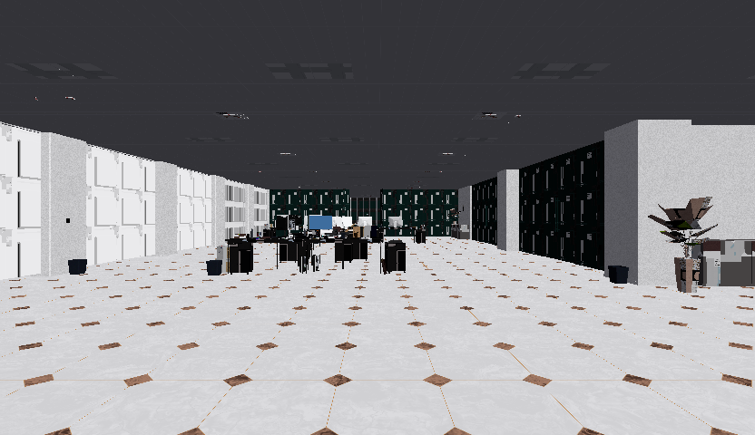
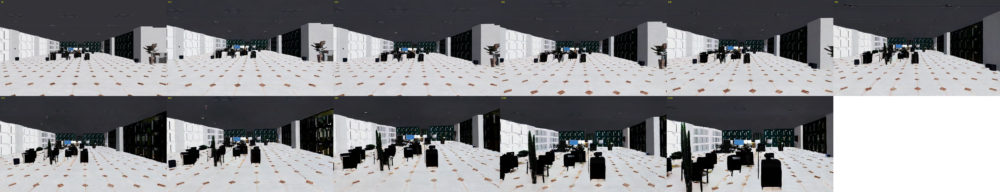

# 第 0–1 阶段：室内起飞拍首帧 → Wan2.2 想象飞行

日期：2026-11-03。硬件：1× H100（Slurm `gpu1`）。代码：`sim/takeoff_capture.py`、`wan/imagine.py`、`wan/sweep_imagine.py`。

## 第 0 阶段：Isaac 室内场景，起飞并拍下首帧

- 场景：Isaac 自带的 Office（`Environments/Office/office.usd`）。物理用 Newton（MuJoCo-Warp），相机用 Newton Warp 渲染器。
  勘察图（16 个候选点 × 4 个朝向）：[`office_survey.jpg`](office_survey.jpg)。
- 起飞点 (-16.2, 27.1)，朝向 90°。3 秒平稳爬升，悬停在 1.21 m，最近障碍 2.13 m。起飞视频：[`takeoff.mp4`](takeoff.mp4)，位姿和相机内参：[`first_pose.json`](first_pose.json)。
- 首帧 I0（832×480，水平视场角 90°）：

已知限制：
- 没有用 Isaac Sim 的 RTX 渲染。原因是 IsaacLab 的 venv 自带 USD 26.08，而 Kit 的 RTX 插件需要 25.11，加上 H100 没有 RT core。
- 办公室的形状全部设成"只可见"：相机能看到，但无人机只会和地板碰撞，撞击要靠深度图来判断。
- 墙面大多是纯灰色，部分材质没有渲染出来，光照偏平。

## 第 1 阶段：Wan2.2-TI2V-5B 想象飞行（I0 + 指令，121 帧 / 24 fps / 5 s，832×480）

**第一次尝试**（[`office_forward.txt`](office_forward.txt)，负向提示词为空）：第一人称、布局保持得很好，但**镜头几乎不动**，后段还出现了紫色伪影。
见 [`baseline_empty_negative.mp4`](baseline_empty_negative.mp4)。

**搜索**（`wan/sweep_imagine.py`）：3 个提示词 × 3 个 seed，负向提示词换成 Wan 官方推荐的那一条（明确惩罚"静态、静止不动的画面"），
另外加上 drone / hand / person。运动用 Farneback 光流衡量：

| 变体 | 光流 px（每 4 帧） | 散度（> 0 = 向前） | curl（≠ 0 = 转向） | 首尾差 |
|---|---:|---:|---:|---:|
| forward_s1 | 8.37 | +0.0626 | +0.0167 | 0.246 |
| **approach_s2**（选用） | 8.36 | +0.0553 | −0.0013 | 0.223 |
| approach_s1 | 6.99 | +0.0519 | +0.0081 | 0.250 |
| forward_s2 | 6.02 | +0.0430 | +0.0010 | 0.193 |
| forward_right_s1 | 5.98 | +0.0417 | −0.0025 | 0.162 |
| approach_s0 | 4.97 | +0.0270 | +0.0016 | 0.148 |
| forward_right_s2 | 3.80 | +0.0078 | −0.0003 | 0.119 |
| forward_right_s0 | 2.57 | −0.0001 | +0.0008 | 0.054 |
| forward_s0 | 1.91 | −0.0000 | −0.0001 | 0.048 |
| *第一次尝试（空负向提示词）* | *2.39* | *+0.0003* | *−0.0003* | *0.065* |

完整的提示词和数据见 [`summary.json`](summary.json)。每个组合约 49 s。

**选用的 approach_s2**（[视频](approach_s2_832x480.mp4)）：向前平稳、方向笔直，场景最连贯。

另外两个运动明显的：[forward_s1](forward_s1_832x480.mp4)（[帧](forward_s1_832x480_frames.jpg)），
[approach_s1](approach_s1_832x480.mp4)（[帧](approach_s1_832x480_frames.jpg)）。

**原生分辨率 1280×704 对比**（approach 提示词，seed 1/2，[`summary_1280x704.json`](summary_1280x704.json)）：

| 变体 | 光流 px（按 832 宽度换算） | 散度 | 首尾差 | 耗时 |
|---|---:|---:|---:|---:|
| approach_s2_1280x704 | 2.89 | +0.0233 | 0.142 | 133 s |
| approach_s1_1280x704 | 1.73 | +0.0135 | 0.106 | 135 s |

画面更稳定，家具形状更一致，但运动小得多，耗时是 480p 的 2.7 倍，而且 token 网格变成 22×40，不再是 DiffWAM 的 15×26。
s2 后段还出现了一个像人坐着的身影。帧总览：[s1](approach_s1_1280x704_frames.jpg)，[s2](approach_s2_1280x704_frames.jpg)。
**结论：继续用 832×480。**

## 观察

- **负向提示词很关键。** 用官方负向提示词后，9 个组合里有 6 个有明显的向前运动（散度 > 0.02），而空负向提示词时几乎静止。
- **seed 影响很大**：同一个提示词，不同 seed 的运动量能差 4 倍（forward：1.9 → 8.4 px）。
- **"转向"没有生成出来**：forward_right 的 curl 都接近 0，Wan 没有执行"右转 90°"。
- **想象会编造或改变家具**：approach_s2 后段凭空多出植物，forward_s1 和 approach_s1 的工位被重新排列。
  所以无人机在仿真里真实飞行时看到的画面，不会和想象画面逐帧一致。第 3 阶段要先验证 latent 误差能不能容忍这种差异。
