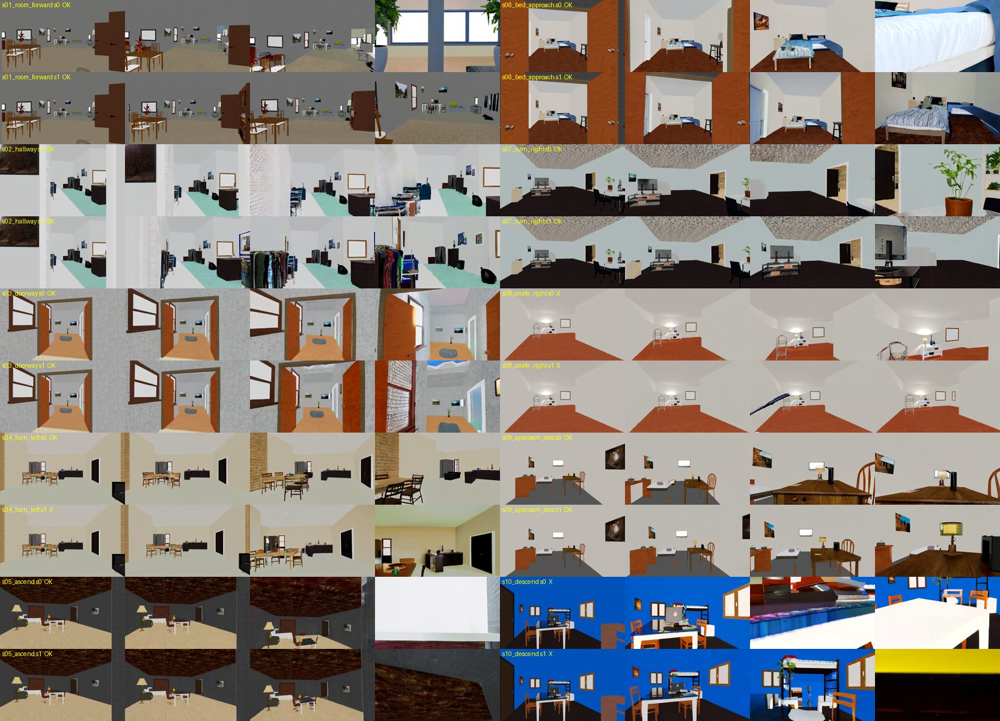

# 10 个场景测试：Wan2.2 想象飞行 → 机载相机编码器 → 按想象视频飞行

日期：2026-11-03。硬件：1× H100（Slurm `gpu1`，作业 339451）。代码：[`follow/`](../../../follow/)。

整个流程：
1. **场景**：HyperDrone（hyperlux 光线追踪 + ProcTHOR 带家具的房子）里，10 栋不同的房子各选一个起飞点（前方空旷、四周有墙），渲染首帧 I0（832×480，水平视场 90°）。
2. **想象**：I0 + 一条指令交给 Wan2.2-TI2V-5B，每个场景 2 个 seed：同一份噪声下，既提取 DiffWAM-Flash 特征（latent 目标），也生成完整视频（121 帧 / 24 fps / 5 s）。
3. **编码器**：训练一个机载图像编码器 E（ResNet-18），把图像映射到 Flash 特征空间；对照组是 Wan2.2 VAE latent（不需要训练）。
4. **跟随**：每个时间槽（5/38 s）试 135 个速度指令，用 HyperDrone 渲染每个指令会看到的画面，编码后与下一个目标的 latent 比较，选误差最小的（加碰撞惩罚）。

## 1. 想象：Wan2.2 能不能按指令生成飞行视频？

10 个场景覆盖 10 种运动（前进、走廊、穿门、左转、上升、接近床、右转、右平移、接近并停下、下降），I0 和指令见
[`scenarios.json`](scenarios.json)，候选起飞画面见 [`I0_candidates.jpg`](I0_candidates.jpg)。

**提示词是关键。** 第一版指令末尾带了"平稳、保持房间不变、不要穿过墙和家具"等约束，结果视频**完全静止**（s01 光流 0.5 px）。
在 s01 上对比 4 种写法后，改成描述镜头运动的写法（"Fast forward dolly shot … strong forward camera motion, objects get
closer and larger every second"）：光流 6.8 px。最终 10 条指令都用这种写法。

**结果**（[`imagination_eval.md`](imagination_eval.md)，总览 [`imagination/overview.jpg`](imagination/overview.jpg)）：

- 20 个视频 **全部在动**（没有静止的），**15/20 的运动方向与指令一致**，10 个场景中 8 个至少有一个 seed 成功。
- 做得好：穿门进卧室接近床（s06）、接近书桌并停下（s09），两个 seed 都很干净；右转（s07 seed 0）、前进、走廊、穿门也成功。
- 方向错误：**右平移（s08）两个 seed 都没执行**（变成向前飘），下降（s10）变成冲向桌面，左转 seed 1 反向。
- 会"编造"：s01 结尾凭空出现窗外城市，s02 多出衣架；s05 上升直接穿进天花板，s10 撞进桌面。**Wan2.2 不理解"不能穿过实体"。**



## 2. 编码器：机载图像能否映射到 Flash latent 空间？——不能

Flash 目标：Z (1, 3 层, 39 槽, 15×26, 3072) 按通道标准化，再按 token PCA 到 64 维（解释 34% 方差）。编码器训练对
=（想象视频在槽 t 的那一帧，槽 t 的目标图）。5 折，每折留出 2 个场景（[`encoder_metrics.json`](encoder_metrics.json)）：

| 5 折平均 | 训练场景 | 留出场景 | 随机水平 |
|---|---:|---:|---:|
| 目标图 R² | 0.57 | **−0.14** | 0 |
| 最近的槽恰好正确 | 34% | **6.5%** | 2.6% |
| 最近的槽在 ±2 内 | 99.9% | **27%** | ~13% |
| latent 误差与时间差的秩相关 | 0.83 | **0.27** | 0 |

**原因验证（同场景换噪声）**：用每个场景的 seed 0 训练、seed 1 测试（房子和指令完全相同，只有噪声不同），R² 从 0.63
降到 **0.03**（[`encoder_metrics_seedsplit.json`](encoder_metrics_seedsplit.json)）。所以 **Flash 在第 0 步的特征主要由这次采样
的随机噪声决定**（未来槽处在 timestep 999/1000），任何图像编码器都无法预测；只有很弱的时间结构（秩相关 0.43）来自上下文。
这不是数据量或编码器的问题，而是 Flash latent 本身的性质。

## 3. 跟随：无人机能否按目标视频飞？

控制器：每个槽试 135 个指令（前进 0–1.2 m/s × 侧移 ±0.4 × 升降 ±0.2 × 偏航 ±0.5 rad/s），渲染一步后的画面，对最好的 16 个
再看两步，代价 = latent 误差（下一槽）+ 0.5 × latent 误差（下下槽）+ 碰撞惩罚（画面中心 < 0.3 m）+ 平滑项。
运动是**运动学**的（完美跟踪速度指令），模拟器在这里充当预测模型——这是检验"latent 误差能否作为控制信号"，还不是 RL 策略。
每个 episode 约 77 s（GPU：OptiX 渲染 + 编码，8.7 GB 显存）。结果：[`follow_eval.md`](follow_eval.md)，视频在 [`follow/`](follow/)
（每个视频左边是目标，右边是无人机的机载画面）。

**(a) 回放测试：有真值的轨迹。** 目标 = 在同一栋房子里脚本飞行渲染出的视频（速度故意不在指令网格上）；
无人机从偏左 0.25 m、偏航 8° 的位置出发，必须先纠正。

| latent 空间 | 成功（终点误差 < 路径长 25%） | 位置 RMSE | 终点误差 | 悬停不动的 RMSE |
|---|---:|---:|---:|---:|
| 像素（15×26 RGB） | 9/10 | 0.19 m | 0.16 m | 1.33 m |
| Wan VAE | 9/10 | 0.21 m | 0.19 m | 1.33 m |
| 编码器 E 的输出空间 | **10/10** | **0.14 m** | **0.11 m** | 1.33 m |

三种空间都能可靠地把无人机带到参考轨迹上。E 作为一个**学到的图像特征空间**效果最好，而且它是在没见过这个场景的那一折上训练的。

**(b) Wan2.2 想象视频：每个场景用较好的那个 seed。**

| latent 目标 | 飞行方向与指令一致 | 其中想象本身正确的场景 | 平均 latent 误差 / 悬停 |
|---|---:|---:|---:|
| **VAE**（想象视频解码后的帧） | **9/10** | **8/8** | 0.66 |
| **Flash**（Z，不解码） | 2/10 | 2/8 | 0.93 |

- **VAE 目标能让无人机按想象视频飞**：例如右转场景偏航 −64° 并前进 4.6 m，接近床 4.2 m，下降 0.45 m。唯一的失败是右平移，
  而那里是想象本身就没有平移——无人机跟着想象视频向前飞了 2.9 m，同时上升了 1.0 m（s08 视频）。
- **Flash 目标基本不动**（大多只移动 0–0.6 m，误差几乎不比悬停低），与第 2 节的结论一致：目标里没有可匹配的信息。

## 4. 结论与下一步

1. **Wan2.2 可以作为"想象器"**：提示词写成镜头运动后，15/20 的想象方向正确，但平移/下降不可靠，而且会穿墙、编造物体。
2. **"在 latent 空间比误差来控制"这条路是可行的**：回放 10/10，VAE 空间跟随 Wan 想象视频 9/10。
3. **但直接用 Flash 特征做目标不可行**：它被采样噪声主导，机载编码器无法对齐。要保留"不解码视频"的速度优势，可以考虑：
   - 去掉噪声分量：在相同噪声下回归掉输入噪声对隐藏状态的贡献，只保留上下文部分作为目标；
   - 对多个 seed 的 Flash 特征取平均，得到期望的未来表示；
   - 用 DiT 对**干净帧**的编码（首帧 A0 那种 token）做目标空间：先用一次完整生成得到想象帧，再离线编码。
4. **下一步（RL）**：把目前"渲染多个候选再选"的控制器换成策略网络——用 VAE（或 E）空间的 latent 误差做奖励，在 HyperDrone
   里用 PPO 训练；控制器的选择可以先作为模仿学习的数据。还要把运动学替换成 L2F 动力学 + 速度控制器，并处理想象中的碰撞。

## 复现

```bash
# env sakana_hyperdrone（HyperDrone + torch），env sakana_dreamer（Wan2.2），在 1 卡 srun 里，目录 follow/
python make_scenarios.py --houses $(seq 1 14) --out-dir scenarios_raw          # 起飞点 + I0
python imagine_scenarios.py --seeds 0 1                                          # sakana_dreamer：Flash + 视频
python analyze_imagination.py                                                    # sakana_dreamer：运动方向评估
python train_encoder.py                                                          # 5 折编码器 + VAE 目标
python train_encoder.py --split seed --out-dir encoders_seedsplit               # 噪声检验
python follow.py --space flash vae pixel                                        # 50 个跟随 episode
python analyze_follow.py && python collect_results.py
```
