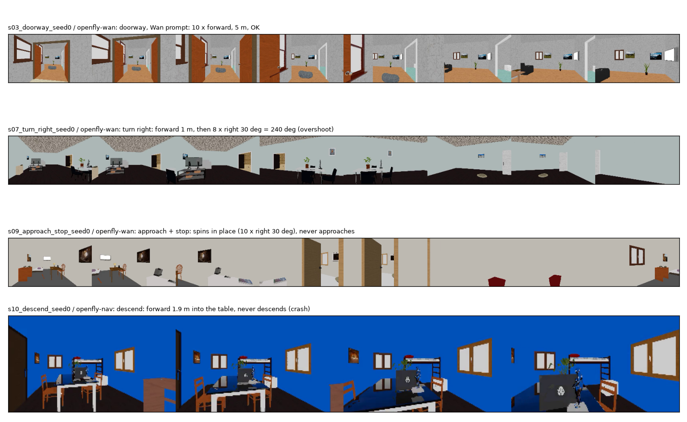

# Zero-shot VLA vs Wan2.2 + DiffWAM as the global planner

Date: 2026-11-04 · Hardware: 1× H100 · Code: [`vla/`](../../../vla/) · Chinese version below / 中文版见下方: [中文](#中文版)

**Question:** can an off-the-shelf aerial VLA replace the Wan2.2 + DiffWAM planner zero-shot, with the same
instructions in the same 20 test cases, and is it faster?

**Answer:** it is faster (0.19 s per decision against 3.2–4 s per plan), but zero-shot it is much less reliable:
4–8 successes out of 20 against 10 for DiffWAM, twice as many crashes, and turns of 240–300° where 30–90° were asked.
**But as the global planner above the Dreamer local planner, called every 1 s, it gave the best result so far:
31/40 successes and 0 crashes, against 22/40 for DiffWAM + Dreamer (section 5).**

## 1. Which VLA

Only one aerial VLA with released weights could run: **OpenFly-Agent v1** (`IPEC-COMMUNITY/openfly-agent-7b`,
OpenVLA 7B: Llama-2 + DINOv2/SigLIP, trained on outdoor aerial VLN in AirSim / UE / Gaussian-splat cities).
- OpenFlyV2 (1B) has no weights yet.
- The small VLAs with weights (SmolVLA 0.45B, MiniVLA 1B, VLA-Adapter 0.5B, NORA 3B) are trained on robot arms. Their
  outputs are arm motions, so they cannot be tested zero-shot on a drone; they would need fine-tuning first.

## 2. Setup

| | Wan2.2 + DiffWAM (current) | OpenFly-Agent v1 (zero-shot) |
|---|---|---|
| Input | I0 (832×480) + Wan camera-move instruction | last 3 onboard frames + instruction, every step |
| Output | 38 poses over 5 s, once | one of 10 discrete actions per step (stop, forward 1/2/3 units, turn ±30°, up/down, left/right) |
| Flight | plan flown kinematically | each action teleports the camera (OpenFly's own protocol); stops at "stop" or after 10 actions |
| Scale | metric plan | OpenFly's 3 m outdoor unit scaled to 0.5 m indoors (forward 0.5 / 1.0 / 1.5 m, up/down/sideways 0.5 m); turns 30° |

Two instruction styles for OpenFly: the same Wan camera-move prompt ("Fast forward dolly shot …"), and a short
navigation-style instruction closer to its training data ("Fly forward through the open doorway into the next room,
then stop in the middle of that room.").

**Three fixes were needed to get any movement.** With OpenFly's released `train/eval.py`, the model answered
"stop" for every case. That script differs from the model's training code in three ways, and I followed the training
code: (1) the Llama-2 chat prompt "What action should the robot take to …?" instead of the raw instruction, (2) the
current frame first instead of oldest first, (3) the 8-dim output mapped to the nearest discrete action. The script
needs an exact match after rounding and calls everything else "stop", but the model often outputs e.g. "forward 5 m".

**Scoring:** the motion rules of `follow/analyze_follow.py`. Crashes use a strict rule: every path is re-flown in
5 cm / 5° steps and checked with the 6-direction depth rig of `dreamer/env.py`. The first pass used the looser rule
of `diffwam/deploy.py`, which only checks the centre of the forward view; it missed obstacles below the image centre.
Yaw is accumulated along the path, so 8 × right 30° counts as −240°, not +120°.

## 3. Results

| Planner | Correct motion | Crashes | **Success** | Success, plausible rotation¹ | Time per decision | Decisions per flight | Model time per flight |
|---|---:|---:|---:|---:|---:|---:|---:|
| **Wan2.2 + DiffWAM** | 13/20 | 3 | **10** | **10** | 3.2–4.0 s² | 1 | 3.2–4.0 s |
| OpenFly-Agent 7B, Wan prompt | 12/20 | 6 | 8 | 4 | **0.19 s** | 6.9 | 1.3 s |
| OpenFly-Agent 7B, navigation prompt | 8/20 | 6 | 6 | 2 | **0.19 s** | 7.0 | 1.3 s |

¹ Also requires a sensible rotation: turns between 15° and 120°, strafe within ±45° of the start heading, other tasks
within ±90°. The motion rules alone accept OpenFly's 240° "right turn" and its "strafe right" done by turning 270°.
² Wan2.2 feature extraction (4 denoising steps) on one H100: 3.2 s when the GPU is free, 3.9–4.0 s measured live
during the replanning test. The DiffWAM head adds 17 ms.

OpenFly is deterministic and the two Wan seeds of a scenario share the start frame and instruction, so its 20 flights
are 10 distinct cases (each counted twice); DiffWAM's 20 plans all differ.

Per case (✓ correct motion, ✗ wrong, 💥 crash; f = forward m, y = yaw deg):

| Scenario | Instruction | Wan2.2 + DiffWAM (seed 0 / seed 1) | OpenFly, Wan prompt | OpenFly, nav prompt |
|---|---|---|---|---|
| s01 | forward | ✓ f2.2 / ✓ f1.2 | ✗ stop at once | ✗ stop at once |
| s02 | hallway | ✗ f0.2 / ✗ f0.0 | ✗ turns left 90° and stops | ✗ spins right 270° |
| s03 | doorway | ✗ f0.4 / ✓ f1.9 | ✓ forward 5 m through the door | ✗ turns right 90° and stops |
| s04 | turn left | ✓ y26 / ✗ y13 | ✓ forward 7.5 m, y60 | ✓ forward 7 m, y90 |
| s05 | ascend | ✓💥 / ✓💥 (into the ceiling) | ✓💥 up into the ceiling | ✗ turns, stops |
| s06 | bed approach | ✓ f2.2 / ✓ f2.6 | ✓💥 forward, turns right, crash | ✓💥 up 1.5 m, crash |
| s07 | turn right | ✓ y−21 / ✓ y−16 | ✓ but y−240 (overshoot) | ✓ but y−210 (overshoot) |
| s08 | strafe right | ✗ / ✗ | ✓ by turning 270° (not a strafe) | ✓ by turning 270° |
| s09 | approach + stop | ✓ f2.0 / ✓ f1.6 | ✗ spins 300° in place | ✗💥 spins, backs into a wall |
| s10 | descend | ✗ / ✓💥 | ✗💥 forward into the table, no descent | ✗💥 same |



Videos: [doorway (works)](s03_doorway_seed0_openfly-wan.mp4) ·
[turn right (240° overshoot)](s07_turn_right_seed0_openfly-wan.mp4) ·
[approach + stop (spins)](s09_approach_stop_seed0_openfly-wan.mp4) ·
[descend (crash into the table)](s10_descend_seed0_openfly-nav.mp4).

## 4. Discussion

- **Speed:** OpenFly is about 17–21× faster per decision. But it needs about 7 decisions per flight, so per flight it
  is only about 2.5–3× faster in model time. Wan + DiffWAM plans 5 s of flight in one call.
- **Quality:** zero-shot, OpenFly knows "forward", "up" and "through the door". It does not know when to stop turning,
  does not descend, cannot strafe, and often stops at once in indoor scenes. Its action units and training scenes are
  outdoor; the unit scaling (1/6) is my choice and affects the result.
- **Instruction style:** OpenFly did better with the Wan camera-move prompt than with the navigation-style one (8 vs 6
  successes). The model is not just pattern-matching VLN phrasing.
- **Safety:** 6 crashes for OpenFly against 3 for DiffWAM. Neither checks obstacles; in the full workflow this is the
  Dreamer local planner's job.
- **Conclusion:** zero-shot, the 7B aerial VLA is not a drop-in replacement for the Wan2.2 + DiffWAM planner. A small VLA
  is worth it only after fine-tuning on our plans (for example SmolVLA distilled from the Wan teacher plans). That is
  the test that would answer "same quality, about 100× faster?".

## 5. OpenFly-Agent v1 as global planner + Dreamer as local planner (closed loop, L2F dynamics)

Same 20 test cases, 2 repeats each (40 flights per arm), 6 s flights in HyperDrone with real L2F dynamics and the
strict crash rule of `dreamer/env.py`. OpenFly is called **every 1 s** (6 calls per flight) with the current view plus
the two previous call views and the Wan prompt. Each action becomes a 1 s plan from the current pose (forward 0.5 m →
0.5 m/s, turn 30° → 30°/s); "stop" holds the current pose. A new plan takes effect after OpenFly's measured latency
(0.18 s) in simulated time. Dreamer is the quick-check model (10% data, short training), see
[the Dreamer report](../dreamer_local_planner/README.md).

| Global planner + local planner | Correct motion | Crashes | **Success** | Distance to plan | Global planner time | Local planner time |
|---|---:|---:|---:|---:|---:|---:|
| DiffWAM (1 plan) + tracker | 26/40 | 6 | 20 | 0.10 m | 3.2–4.0 s once | — |
| DiffWAM (1 plan) + Dreamer | 22/40 | **0** | 22 | 0.55 m | 3.2–4.0 s once | 3.7 ms / 0.1 s |
| OpenFly every 1 s + tracker | 18/40 | 6 | 14 (12 with plausible rotation) | 0.18 m | 0.18 s × 6 | — |
| **OpenFly every 1 s + Dreamer** | **31/40** | **0** | **31** | 0.27 m | 0.18 s × 6 | 3.7 ms / 0.1 s |
| OpenFly every 1 s + Dreamer + shield | 29/40 | 1 | 28 | 0.28 m | 0.18 s × 6 | 16 ms / 0.1 s |
| *control: "hover" plan + Dreamer* | 5/40 | 0 | 5 | 0.33 m | — | 3.7 ms / 0.1 s |
| *control: instruction prior + Dreamer* | 21/40 | 3 | 18 | 0.32 m | — | 3.7 ms / 0.1 s |

Successes per instruction (out of 4 flights each):

| | forward | hallway | doorway | turn left | ascend | bed approach | turn right | strafe right | approach + stop | descend |
|---|---|---|---|---|---|---|---|---|---|---|
| DiffWAM + tracker | 4 | 0 | 2 | 2 | 0 (ceiling) | 4 | 4 | 0 | 4 | 0 |
| DiffWAM + Dreamer | 4 | 0 | 2 | 0 | 4 | 4 | 4 | 0 | 4 | 0 |
| OpenFly + tracker | 0 | 0 | 4 | 0 | 0 (ceiling) | 4 | 4 | 0 | 0 | 0 |
| **OpenFly + Dreamer** | 4* | 4 | 4 | 0 | 4 | 4 | 4 | 0 | 4 | 3 |
| hover + Dreamer (control) | 4* | 0 | 0 | 0 | 1 | 0 | 0 | 0 | 0 | 0 |

\* "forward" passes at > 0.5 m, and Dreamer drifts 0.5–0.7 m forward even when told to hover, so the forward
column is not evidence for either planner.

What happened, case by case (OpenFly + Dreamer, repeat 0):

| Scenario | OpenFly's 6 actions | Flown (forward / up / yaw) |
|---|---|---|
| s01 forward | stop | 0.6 m / +0.1 / −9° (Dreamer drift, as in the control) |
| s02 hallway | left 30° ×4, forward 1 m ×2 | 1.4 m / +0.3 / +13° |
| s03 doorway | forward 0.5 m ×5, stop | 1.6 m / −0.2 / −15° |
| s04 turn left | forward 1 m ×6 | 2.8 m / +0.5 / −16° (no left turn asked by OpenFly) |
| s05 ascend | up 0.5 m ×6 | 0.5 m / **+0.2** / +5° (plan into the ceiling; Dreamer barely climbs) |
| s06 bed approach | forward 1 m ×3, forward, right 30°, forward | 2.3 m / +0.3 / −71° |
| s07 turn right | forward 1 m ×3, right 30° ×3 | 1.7 m / +0.3 / −33° |
| s08 strafe right | right 30° ×4, forward 1 m, right 30° | 1.3 m / +0.2 / −40° |
| s09 approach + stop | right 30° ×6 | 1.0 m / +0.2 / −60° |
| s10 descend | forward 0.5 m ×5, stop | 0.8 m / **−0.2** / +20° |

Videos: [doorway](s03_doorway_seed0_openfly+dreamer.mp4) ·
[ascend, tracker into the ceiling](s05_ascend_seed0_openfly+track.mp4) vs
[ascend, Dreamer](s05_ascend_seed0_openfly+dreamer.mp4) ·
[approach + stop](s09_approach_stop_seed0_openfly+dreamer.mp4).

**Findings**

1. **OpenFly + Dreamer is the best combination so far: 31/40 successes, 0 crashes**, against 22/40 for DiffWAM +
   Dreamer and 14/40 for OpenFly + tracker. Called every second, OpenFly's small discrete steps keep correcting the
   course, and Dreamer turns them into smooth, safe flight. Its big zero-shot errors are damped: Dreamer does not
   follow a 300° spin or a climb into the ceiling.
2. **It is fast:** 0.18 s per OpenFly call (6 per flight) plus 3.7 ms per Dreamer step, against 3.2–4.0 s for one
   Wan2.2 + DiffWAM plan.
3. **The control shows Dreamer is following the plans:** with a "hover" plan Dreamer drifts 0.1–0.5 m and passes only
   5/40 (the lenient forward rule, plus one ascend). With OpenFly's plans it passes hallway, doorway, approach,
   approach + stop, ascend and descend.
4. **Caveats:**
   - The motion rules are lenient: forward > 0.5 m, ascend > 0.2 m, descend < −0.1 m. Several passes are small
     motions; ascend reached only +0.2 m and descend only −0.2 m.
   - Some passes are not what the instruction meant: approach + stop passes by drifting forward while OpenFly only
     turns.
   - Turn left and strafe right still fail for every arm.
   - The Dreamer here is the quick-check model, and OpenFly's unit scaling (1/6) is my choice.
   - OpenFly is deterministic, so the 4 flights per instruction are 2 distinct OpenFly sequences × 2 Dreamer runs.
5. **Next step:** run the same comparison with the full Dreamer model, and with a stricter motion rule that compares
   the flown path with the instruction's expected displacement, not just a threshold.

## Reproduce

```bash
git clone https://github.com/SHAILAB-IPEC/OpenFly-Platform ~/vla/OpenFly-Platform   # its HF model classes
# env sakana_vla: python 3.10, torch 2.5.1 cu124, transformers 4.47.1, timm 0.9.16, huggingface_hub < 1
bash vla/run_zeroshot.sh                         # server (sakana_vla) + eval_zeroshot.py (sakana_hyperdrone)
python vla/rescore.py                            # strict crash rule, unwrapped yaw
bash vla/run_openfly_dreamer.sh                  # OpenFly every 1 s + Dreamer local planner, L2F dynamics
```

---

## 中文版

# 零样本 VLA 与 Wan2.2 + DiffWAM 作为全局规划器的对比

日期：2026-11-04 · 硬件：1× H100 · 代码：[`vla/`](../../../vla/)

**问题：** 在同样 20 个测试场景、同样的指令下，现成的空中 VLA 能否零样本替代 Wan2.2 + DiffWAM 规划器？会不会更快？

**结论：** 它更快（每次决策 0.19 秒，而 Wan 每个计划要 3.2–4 秒），但零样本时可靠性差很多：20 次中成功 4–8 次，
DiffWAM 是 10 次；碰撞是 DiffWAM 的两倍；要求转 30–90° 时它会转 240–300°。
**但如果把它作为 Dreamer 局部规划器之上的全局规划器、每 1 秒调用一次，得到的是目前最好的结果：40 次中成功 31 次、
0 次碰撞；DiffWAM + Dreamer 是 22 次（第 5 节）。**

### 1. 用的是哪个 VLA

能运行的、有公开权重的空中 VLA 只有 **OpenFly-Agent v1**（`IPEC-COMMUNITY/openfly-agent-7b`）。它基于 OpenVLA 7B
（Llama-2 + DINOv2/SigLIP），训练数据是 AirSim / UE / 高斯泼溅城市中的室外空中视觉语言导航。
- OpenFlyV2（1B）还没有发布权重。
- 有权重的小型 VLA（SmolVLA 0.45B、MiniVLA 1B、VLA-Adapter 0.5B、NORA 3B）都是在机械臂上训练的，输出的是机械臂动作，
  无法零样本用于无人机，必须先微调。

### 2. 设置

| | Wan2.2 + DiffWAM（现有） | OpenFly-Agent v1（零样本） |
|---|---|---|
| 输入 | I0（832×480）+ Wan 的镜头运动指令 | 每一步：最近 3 帧机载画面 + 指令 |
| 输出 | 一次给出 5 秒内的 38 个位姿 | 每一步从 10 个离散动作中选一个（停止、前进 1/2/3 个单位、转 ±30°、上/下、左/右） |
| 飞行方式 | 按运动学飞完计划 | 每个动作直接把相机移到新位置（OpenFly 自己的评估方式）；遇到"停止"或 10 步后结束 |
| 尺度 | 计划是公制的 | OpenFly 的室外单位 3 m，室内缩放为 0.5 m（前进 0.5 / 1.0 / 1.5 m，上/下/侧移 0.5 m）；转向仍为 30° |

OpenFly 测了两种指令：一种与 Wan 用的镜头运动指令相同（"Fast forward dolly shot …"），另一种是更接近它训练数据的
简短导航指令（"Fly forward through the open doorway into the next room, then stop in the middle of that room."）。

**需要三处修正，模型才会动。** 用 OpenFly 官方发布的 `train/eval.py`，模型对所有场景都输出"停止"。这个脚本与模型的
训练代码有三处不一致，我按训练代码来：
1. 使用 Llama-2 对话格式 "What action should the robot take to …?"，而不是直接传入原始指令；
2. 当前帧放在最前，而不是最早的帧在前；
3. 把 8 维输出映射到最近的离散动作。原脚本要求四舍五入后完全匹配，否则一律算"停止"，而模型经常输出"前进 5 m"这样的值。

**评分：** 运动是否正确沿用 `follow/analyze_follow.py` 的规则。碰撞用严格规则：每条路径都按 5 cm / 5° 的步长重新飞一遍，
用 `dreamer/env.py` 的 6 方向深度检测。第一轮用的是 `diffwam/deploy.py` 较宽松的规则，只看前视图中央，会漏掉画面中心以下的
障碍物。偏航角沿路径累计，所以 8 次右转 30° 记为 −240°，而不是 +120°。

### 3. 结果

| 规划器 | 方向正确 | 碰撞 | **成功** | 成功且转角合理¹ | 每次决策耗时 | 每次飞行的决策数 | 每次飞行的模型耗时 |
|---|---:|---:|---:|---:|---:|---:|---:|
| **Wan2.2 + DiffWAM** | 13/20 | 3 | **10** | **10** | 3.2–4.0 秒² | 1 | 3.2–4.0 秒 |
| OpenFly-Agent 7B，Wan 指令 | 12/20 | 6 | 8 | 4 | **0.19 秒** | 6.9 | 1.3 秒 |
| OpenFly-Agent 7B，导航指令 | 8/20 | 6 | 6 | 2 | **0.19 秒** | 7.0 | 1.3 秒 |

¹ 额外要求转角合理：转弯在 15° 到 120° 之间，侧移时朝向偏离起始方向不超过 ±45°，其他任务不超过 ±90°。仅按运动规则，
OpenFly 的 240°"右转"和靠转 270° 完成的"右平移"都会算对。
² Wan2.2 特征提取（4 步去噪）在单张 H100 上：GPU 空闲时 3.2 秒，在线重新规划测试中实测 3.9–4.0 秒。DiffWAM 读出头另加 17 ms。

OpenFly 是确定性的，而同一场景的两个 Wan seed 共用同一首帧和指令，所以它的 20 次飞行实际上只有 10 个不同的情况
（每个算了两次）；DiffWAM 的 20 个计划各不相同。逐场景结果见英文版表格。

### 4. 讨论

- **速度：** 每次决策 OpenFly 快约 17–21 倍。但一次飞行它需要约 7 次决策，所以按每次飞行的模型耗时只快约 2.5–3 倍。
  Wan + DiffWAM 一次调用就规划好 5 秒的飞行。
- **质量：** 零样本时，OpenFly 懂"前进""上升""穿过门"，但不知道什么时候停止转向，不会下降，不会平移，在室内场景里
  经常一开始就停住。它的动作单位和训练场景都是室外的；单位缩放（1/6）是我选的，会影响结果。
- **指令风格：** OpenFly 用 Wan 的镜头运动指令反而比用导航指令表现更好（成功 8 次对 6 次），说明它并不只是匹配导航句式。
- **安全性：** OpenFly 碰撞 6 次，DiffWAM 3 次。两者都不检查障碍物；在完整工作流中，这是 Dreamer 局部规划器的任务。
- **结论：** 零样本的 7B 空中 VLA 不能直接替代 Wan2.2 + DiffWAM 规划器。小型 VLA 只有在用我们的计划微调后才值得用（例如用
  Wan 老师计划蒸馏 SmolVLA），那才是回答"质量相同、快约 100 倍？"的实验。

### 5. OpenFly-Agent v1 作全局规划 + Dreamer 作局部规划（闭环，L2F 动力学）

同样 20 个测试场景，每个跑 2 次（每种方案共 40 次飞行），在 HyperDrone 中用真实 L2F 动力学飞 6 秒，碰撞用 `dreamer/env.py`
的严格规则。OpenFly **每 1 秒调用一次**（每次飞行共 6 次），输入当前画面、前两次调用时的画面和 Wan 指令。每个动作变成从当前
位姿出发的 1 秒计划（前进 0.5 m → 0.5 m/s，转 30° → 30°/s）；"停止"则保持当前位姿。新计划在 OpenFly 实测延迟（0.18 秒，按模拟
时间计）之后才生效。Dreamer 用的是小规模检查的模型（10% 数据、短时间训练）。

| 全局规划 + 局部规划 | 方向正确 | 碰撞 | **成功** | 离计划距离 | 全局规划耗时 | 局部规划耗时 |
|---|---:|---:|---:|---:|---:|---:|
| DiffWAM（单次计划）+ 跟踪器 | 26/40 | 6 | 20 | 0.10 m | 一次 3.2–4.0 秒 | — |
| DiffWAM（单次计划）+ Dreamer | 22/40 | **0** | 22 | 0.55 m | 一次 3.2–4.0 秒 | 每 0.1 秒 3.7 ms |
| OpenFly 每 1 秒 + 跟踪器 | 18/40 | 6 | 14（转角合理的 12） | 0.18 m | 0.18 秒 × 6 | — |
| **OpenFly 每 1 秒 + Dreamer** | **31/40** | **0** | **31** | 0.27 m | 0.18 秒 × 6 | 每 0.1 秒 3.7 ms |
| OpenFly 每 1 秒 + Dreamer + 安全检查 | 29/40 | 1 | 28 | 0.28 m | 0.18 秒 × 6 | 每 0.1 秒 16 ms |
| *对照："悬停"计划 + Dreamer* | 5/40 | 0 | 5 | 0.33 m | — | 每 0.1 秒 3.7 ms |
| *对照：指令先验 + Dreamer* | 21/40 | 3 | 18 | 0.32 m | — | 每 0.1 秒 3.7 ms |

各指令的成功次数和逐场景动作见英文版表格。

**结论**

1. **OpenFly + Dreamer 是目前最好的组合：40 次中成功 31 次、0 次碰撞**；DiffWAM + Dreamer 是 22 次，OpenFly + 跟踪器是 14 次。
   每秒调用一次时，OpenFly 的小步离散动作会不断修正方向，Dreamer 把它们变成平滑、安全的飞行。OpenFly 零样本时的大错误也被
   削弱了：Dreamer 不会跟着原地转 300°，也不会一直爬升撞到天花板。
2. **速度快：** OpenFly 每次调用 0.18 秒（每次飞行 6 次），Dreamer 每步 3.7 ms；而 Wan2.2 + DiffWAM 一个计划要 3.2–4.0 秒。
3. **对照实验说明 Dreamer 确实在跟随计划：** 给"悬停"计划时，Dreamer 只漂移 0.1–0.5 m，40 次中只成功 5 次（来自宽松的
   "前进"规则，以及一次上升）。给 OpenFly 的计划时，走廊、穿门、接近、接近并停下、上升、下降都成功了。
4. **注意事项：**
   - 运动规则比较宽松：前进 > 0.5 m，上升 > 0.2 m，下降 < −0.1 m。有几次成功的运动幅度很小，上升只到 +0.2 m，下降只到 −0.2 m。
   - 有些成功并不是指令的本意：例如"接近并停下"能通过，是因为 OpenFly 只在转向时 Dreamer 向前漂移了。
   - 左转和右平移对所有方案都失败。
   - 这里的 Dreamer 是小规模检查的模型；OpenFly 的单位缩放（1/6）是我选的。
   - OpenFly 是确定性的，所以每条指令的 4 次飞行实际是 2 个不同的 OpenFly 动作序列 × 2 次 Dreamer 飞行。
5. **下一步：** 用完整训练的 Dreamer 重做这个比较，并用更严格的运动规则：把飞出的路径与指令期望的位移比较，而不只是看阈值。
